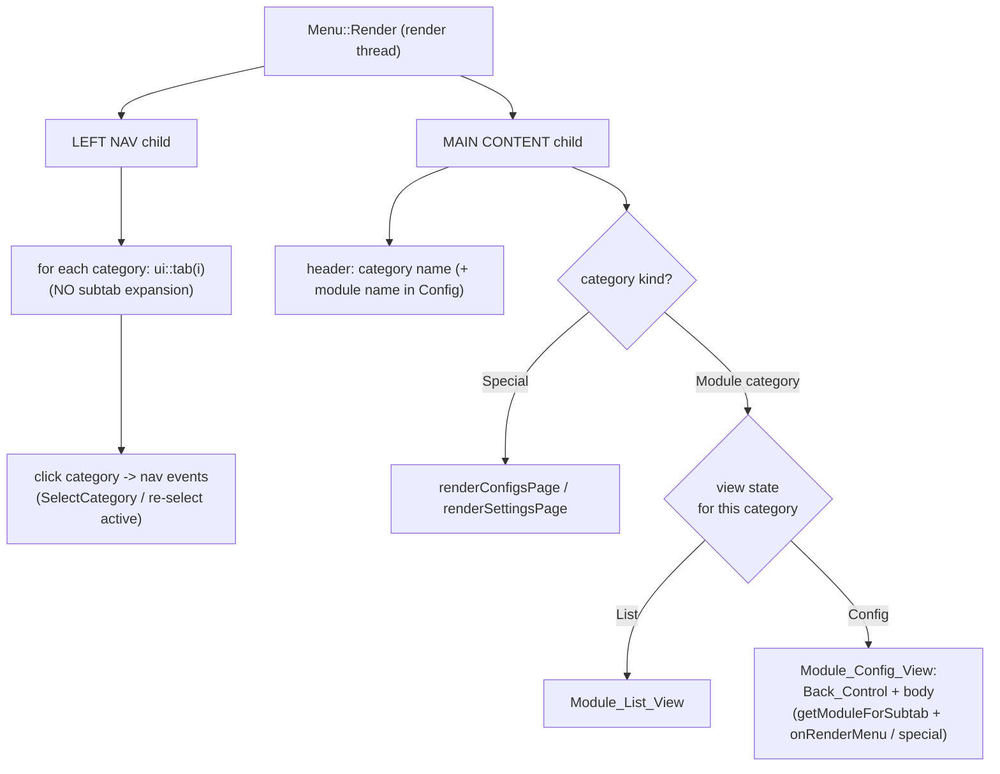
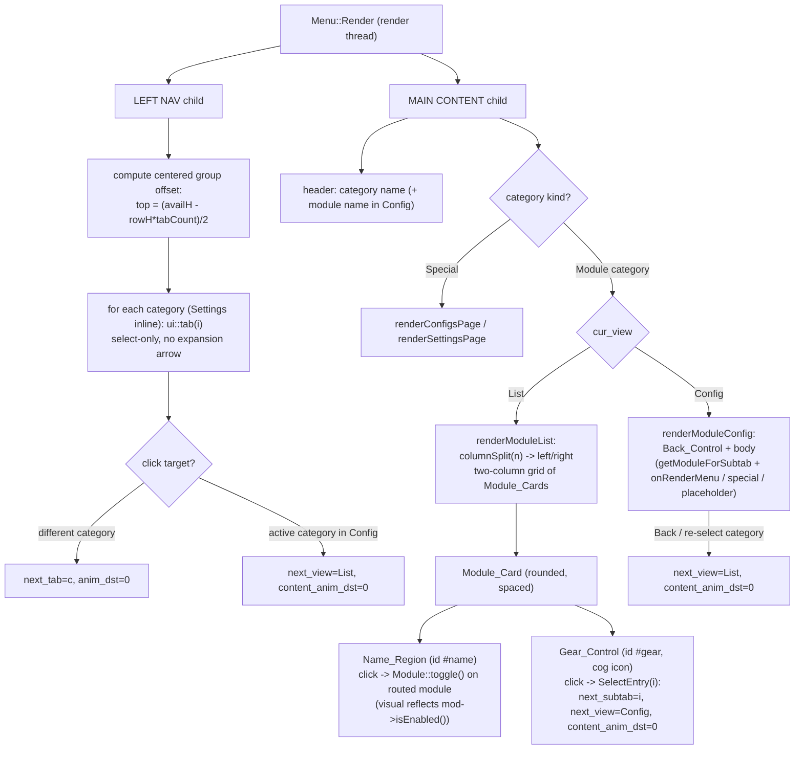

# Design Document

## Overview

This redesign changes how the Cobble ImGui OpenGL2 overlay (`Menu::Render` in `src/ui/menu/menu.cpp`) presents navigation, and refines that redesign with a softer, more card-based look and more direct module interactions.

The original (already-implemented) model moved module selection out of the sidebar and into the main content area:

- The sidebar shows only the six top-level categories (Combat, Visuals, Movement, Utility, Configs, Settings).
- Selecting a `Module_Category` (Combat/Visuals/Movement/Utility) shows its modules as a selectable list in the main content area (`Module_List_View`).
- Selecting a module animates a transition to a dedicated `Module_Config_View` that renders the module's `onRenderMenu()` (or the inline ArrayList/Notifications special pages).
- A `Back_Control` (and re-selecting the active category) returns to the `Module_List_View`.
- `Configs` and `Settings` are `Special_Categories` that render their existing pages directly with no list/config split.

This revision layers six refinements on top of that model:

1. **Softer corners.** The window, its containers, and the module cards use a larger, single-sourced corner rounding.
2. **Click name to toggle.** Clicking a `Module_Entry`'s name now toggles the module's enabled state (it no longer opens the config).
3. **Gear opens configuration.** A gear (cog) control on each entry opens the module's config, replacing the chevron affordance.
4. **Module cards.** Each entry is a separated, rounded card with spacing instead of a flush row.
5. **Two-column grid.** The module list arranges cards in two columns.
6. **Centered categories.** The category items (including Settings) are vertically centered as one group; Settings is no longer pinned to the bottom.

The change remains deliberately **cosmetic and low-risk**. It does not touch validation, handshake, integrity, security, threading, or persistence. It reuses the existing animation primitives (`ui::anim`, `ui::content_anim`, `ui::anim_obj`, `ui::animate`) and the centralized `getModuleForSubtab` routing. The key navigation concept is unchanged: a **per-category view state** (`List` vs `Config`) layered on top of `cur_tab`/`cur_subtab`, so routing is completely unchanged. The new name-toggle is a **render-side action that is intentionally outside** the navigation state machine: it mutates module state, not view state.

### Design Goals and Non-Goals

**Goals**
- Sidebar renders categories only, no expansion affordance, with the whole group (Settings included) vertically centered.
- Module list shows each module as a rounded, spaced card laid out in two columns.
- Clicking a card's name toggles the module; clicking the card's gear opens its config — two distinct, non-overlapping hit areas.
- Larger, consistent corner rounding driven from a single source value scaled by `ui::s`.
- Smooth, fade-consistent transition between list and config, reusing existing animation helpers.
- Preserve every existing behavior: `onRenderMenu`, locked/unlock flow, ArrayList/Notifications/DroppedInfo, Configs one-shot refresh, persistence, and the existing module toggle path.

**Non-Goals**
- No change to module logic, routing table contents, config schema, threading, or any security path.
- No new ImGui primitives that bypass the `ui::` wrappers / drawlist+`ButtonBehavior` pattern (raw `ImGui::` interactive widgets break the menu fade).
- No new JNI on the render thread. The name-toggle reuses the **existing** `Module::toggle()` / `Module::setEnabled()` path, which already runs on the render thread today (e.g. the `Enabled` checkbox inside `onRenderMenu()` and the Settings PANIC button both call `setEnabled` on the render thread). `onEnable`/`onDisable` behavior is unchanged.
- No behavioral difference between dev and pack builds.

## Architecture

### Current architecture (model, unchanged)



Navigation state lives in two globals and the per-tab struct:
- `ui::cur_tab` / `ui::next_tab` — active category; clicking a different category sets `next_tab` and `anim_dst = 0`.
- `tab_t::cur_subtab` / `tab_t::next_subtab` — selected module within the category.
- `tab_t::cur_view` / `tab_t::next_view` — `List` vs `Config` for that category.
- `ui::handle_anims()` lerps `anim` and `content_anim` toward their `*_dst` values, and **commits** the pending `cur_subtab`/`cur_view` at the content animation midpoint.

### Target architecture (after this revision)

The structural changes are confined to the render thread and split into **navigation** (unchanged at the model level) and **presentation** (the six refinements). The mermaid below shows the refined `Module_List_View` and the new sidebar/card interactions.



What changed in this revision, all on the render thread:

1. **Rounding (`theme.cpp` + draw calls).** A single source of base rounding radii (`ui::theme::rounding`) is raised and consumed once in `theme::apply()`. Existing `menu.cpp`/`widgets.cpp` draw calls already read `GImGui->Style.WindowRounding`/`ChildRounding`, so they inherit the larger radii automatically; the only new explicit radius is the `Module_Card` radius, which reads the same source scaled by `ui::s`.
2. **Sidebar (`Menu::Render` "tabs" child).** Replace the bottom-pin layout (the `Dummy` spacer + separator that pushed Settings down) with a vertically centered `Category_Group` that includes Settings inline.
3. **Module list (`renderModuleList`).** Rebuilt as a two-column grid of `Module_Card`s, each with a `Name_Region` (toggles) and a `Gear_Control` (opens config) as two separate hit areas.
4. **`MenuNav` model.** Unchanged in semantics. `SelectEntry` is now triggered by the gear instead of the whole row; the name-toggle is a separate render-side action that is not part of the model.

Everything continues to run exclusively on the OpenGL render thread; no JNI is introduced. Cached values consumed by `onRenderMenu()` continue to come from `VisualCache`/`onUpdate()` as before.

## Components and Interfaces

### 1. View-state model layered on the tab system (unchanged)

`tab_t` carries the per-category view dimension already in the codebase:

```cpp
namespace ui {

enum class CategoryView { List, Config };

struct tab_t {
    const char* m_icon;
    const char* m_name;
    int cur_subtab  = 0;
    int next_subtab = 0;

    CategoryView cur_view  = CategoryView::List;   // per-category view state
    CategoryView next_view = CategoryView::List;

    std::vector<const char*> m_subtabs;
    // ctor unchanged
};

} // namespace ui
```

**Why reuse `content_anim`.** The subtab swap and the view swap are the same kind of "content changed in the main area" transition. `handle_anims()` already fades the content out, swaps `cur_subtab = next_subtab` and `cur_view = next_view` at the midpoint, and fades back in:

```cpp
content_anim = ImLerp(content_anim, content_anim_dst, 21.f * ImGui::GetIO().DeltaTime);
if (abs(content_anim - content_anim_dst) < 0.01f) {
    content_anim_dst = 1.f;
    if (cur_tab < tabs.size()) {
        tabs[cur_tab].cur_subtab = tabs[cur_tab].next_subtab;
        tabs[cur_tab].cur_view   = tabs[cur_tab].next_view;
    }
}
```

list→config and config→list animate with exactly the same fade the menu already uses, satisfying Requirement 8 with no new animation code. Because the swap is driven by the lerp reaching its target (and `content_anim_dst` is always reset to `1.f`), the commit is **guaranteed to happen on a subsequent frame even if the animation is degenerate** — this backs Requirement 8.4.

### 2. `MenuNav` — pure navigation transition logic (semantics unchanged)

The transition logic stays in a small pure component with **no ImGui dependency**.

```cpp
// src/ui/menu/menu_nav.hpp  (pure, header-only, no ImGui include)
namespace nav {

enum class ViewKind { List, Config, SpecialPage };

struct CategoryInfo {
    bool isSpecial;   // Configs / Settings
    int  entryCount;  // number of Module_Entry items (m_subtabs.size())
};

struct NavState {
    int      category     = 0;
    int      entry        = 0;            // selected module index within category
    ViewKind view         = ViewKind::List;
    int      nextCategory = 0;
    int      nextEntry     = 0;
    ViewKind nextView      = ViewKind::List;
};

enum class Event { SelectCategory, SelectEntry, Back };

NavState requestTransition(NavState s, Event e, int arg, const CategoryInfo& info);
NavState commit(NavState s);
ViewKind resolveView(const NavState& s, const CategoryInfo& info);

} // namespace nav
```

Transition rules implemented by `requestTransition` (unchanged):

- **SelectCategory(c)**, `c` different: `nextCategory = c`; special → `nextView = SpecialPage`, else `nextView = List`.
- **SelectCategory(c)**, `c == category`, `Module_Category` in `Config`: `nextView = List` (re-select returns to list — Req 9.3). Idempotent if already `List`.
- **SelectEntry(i)** (valid only in a `Module_Category`'s list): `nextEntry = clamp(i)`, `nextView = Config` (Req 4.2, 4.4). **Now triggered by the `Gear_Control`, not the whole row.**
- **Back** (valid only in `Config`): `nextView = List`, category/entry preserved (Req 9.2, 9.4).

`menu.cpp` maps `MenuNav` to the live `ui::` state: `category <-> cur_tab`, `entry <-> tabs[t].cur_subtab`, `view <-> tabs[t].cur_view`, and the `next*` fields to `next_tab`/`next_subtab`/`next_view`. Requesting a transition sets the appropriate `*_dst = 0.f`. Routing stays centralized: the entry index feeds straight into `getModuleForSubtab(cur_tab, cur_subtab)`.

**The name-toggle is not modeled here.** Activating a `Name_Region` calls `Module::toggle()` on the routed module and returns; it does not produce a `nav::Event`, does not set any `*_dst`, and never changes `category`/`entry`/`view`. This keeps the navigation state machine clean and is why the toggle is covered by integration/example tests rather than a nav property (see Testing Strategy).

### 3. Corner rounding — single source scaled by `ui::s` (Req 7)

Today rounding is set in two places with small radii:

- `ui::theme::apply()` (`theme.cpp`): `style.WindowRounding = s(4)`, `ChildRounding = s(3)`, `FrameRounding = s(3)`, `GrabRounding = s(3)`, `PopupRounding = s(4)`, `ScrollbarRounding = s(3)`.
- Draw calls in `menu.cpp` (window bg/border, brand, tabs child, header, content background) and `widgets.cpp` (`begin_child` container + header, checkbox/binder frames) read `GImGui->Style.WindowRounding` / `GImGui->Style.ChildRounding` / `style.FrameRounding` — i.e. they already consume the style values rather than hardcoding their own radii.

**New approach: one base-radius source, consumed once.** Introduce a small set of unscaled base radii in the theme header so there is a single place to tune softness:

```cpp
// theme.hpp
namespace ui { namespace theme { namespace rounding {
    inline constexpr float Window     = 10.f;  // was 4
    inline constexpr float Child      =  8.f;  // was 3
    inline constexpr float Frame      =  6.f;  // was 3
    inline constexpr float Grab       =  6.f;  // was 3
    inline constexpr float Popup      = 10.f;  // was 4
    inline constexpr float Scrollbar  =  6.f;  // was 3
    inline constexpr float ModuleCard =  8.f;  // matches Child for visual consistency
}}}
```

`theme::apply()` becomes the single consumer that scales these into the live ImGui style:

```cpp
style.WindowRounding    = s(rounding::Window);
style.ChildRounding     = s(rounding::Child);
style.FrameRounding     = s(rounding::Frame);
style.GrabRounding      = s(rounding::Grab);
style.PopupRounding     = s(rounding::Popup);
style.ScrollbarRounding = s(rounding::Scrollbar);
```

Because every existing rounded draw call already reads `GImGui->Style.*`, raising these constants makes the window, sidebar, header, and content containers softer with **no per-call literal changes** (Req 7.1, 7.2). The `Module_Card` is the only element that draws its own radius; it uses the same source scaled at draw time: `ui::s(ui::theme::rounding::ModuleCard)` (Req 7.3). All new radii are strictly larger than the previous values (Req 7.4). Scaling stays centralized through `ui::s`, so rounding tracks DPI/resolution exactly as the rest of the UI does.

### 4. Sidebar rendering changes (`ui::tab` + the "tabs" child)

`ui::tab(int)` is already select-only (no `ui::subtab` rows, no expansion arrow), satisfying Req 1.1, 1.2, 1.5. Its click behavior is unchanged:
- Clicking a **different** category: `next_tab = num; anim_dst = 0.f;`.
- Clicking the **already-active** `Module_Category` while in `Config`: `tabs[num].next_view = List; content_anim_dst = 0.f;` (Req 9.3).

**What changes is the layout of the "tabs" child in `Menu::Render`** to satisfy Req 1.4 and Req 1.6. Today the loop renders categories `0 .. size-2`, then inserts a `Dummy` spacer sized to push the last tab down, draws a separator, and renders Settings (`size-1`) pinned to the bottom. This revision removes the bottom-pin entirely and renders the **whole `Category_Group` (all categories, Settings inline) as one vertically centered block**:

```text
// inside the "tabs" child, after the top Dummy({0, s(6)})
rowHeight  = s(38)                          // ui::tab fixed row height
tabCount   = ui::tabs.size()                // all categories incl. Settings
groupH     = rowHeight * tabCount
availH     = ImGui::GetContentRegionAvail().y
topOffset  = max(0, (availH - groupH) * 0.5f)

ImGui::Dummy({0, topOffset})                // center the group vertically
ImGui::BeginGroup();
for (i = 0; i < tabCount; ++i)              // Settings is just tabs.back()
    ui::tab(i);
ImGui::EndGroup();
```

- The `Dummy`/separator bottom-pin block is deleted (Req 1.4: Settings inline, not pinned).
- `topOffset = (availH - groupH)/2` centers the group; clamped to `0` so a short panel simply top-aligns instead of clipping (Req 1.6).
- The separator line that previously sat above Settings is removed; the per-row bottom border drawn inside `ui::tab` already separates rows uniformly, so Settings now looks identical to the other categories.
- The brand area, the tabs-child background fill, and the per-tab icon+label+selection animation are unchanged.

`ui::subtab()` remains unused by the sidebar path (kept for now to minimize churn).

### 5. Module list rendering changes (`renderModuleList`) — cards, columns, name/gear

`renderModuleList(tab)` is rebuilt from the current single-column row list into a **two-column grid of rounded `Module_Card`s**, each carrying a `Name_Region` and a `Gear_Control` as two separate hit areas. It stays inside a `ui::section`/`ui::begin_child` container so it fades with the menu, and uses the drawlist + `ButtonBehavior` pattern (no raw ImGui interactive widgets — Req 14.1).

**Two-column geometry (Req 6).** The split is pure index math, extracted so it can be unit/property tested independently of ImGui:

```cpp
// pure helper (no ImGui): returns the split index between left and right columns
// left column gets the leading prefix; odd counts put the extra card on the left.
inline int columnSplit(int n) { return (n + 1) / 2; }   // == ceil(n/2)
```

Layout:

```text
n        = t.m_subtabs.size()
split    = columnSplit(n)                     // left = [0, split), right = [split, n)
gap      = ui::s(10)                          // horizontal gap between columns (Req 6.4)
avail    = ImGui::GetContentRegionAvail().x
cardW    = (avail - gap) / 2                  // each column width
cardH    = ui::s(34)
cardGapY = ui::s(8)                           // vertical spacing between cards (Req 5.2)

// Build the two ordered lists, left filled first in entry order (Req 6.2, 6.3):
left  = entries[0 .. split)
right = entries[split .. n)

// Render as two vertical groups side by side:
BeginGroup(); for c in left  { drawCard(c, cardW, cardH); Dummy({0, cardGapY}); } EndGroup();
SameLine(0, gap);
BeginGroup(); for c in right { drawCard(c, cardW, cardH); Dummy({0, cardGapY}); } EndGroup();
```

For Combat's ten modules, `columnSplit(10) = 5`, so five cards render left and five right. For an odd category (e.g. seven entries), `columnSplit(7) = 4`, so the left column gets the extra card (Req 6.3). The whole grid is drawn under the menu's `contentAlpha`, so it fades with the menu (Req 8.3, list side).

**`Module_Card` (Req 5).** Each `drawCard(i, w, h)` lays out one entry:

```text
bb = rounded rect of size (w, h) at the current group cursor
m  = getModuleForSubtab(tab, i)              // centralized routing (Req 3.3, 4.4)
isLocked  = m && m->showsDeveloperOnly()
isEnabled = m && m->isEnabled()

// Card background (rounded, Req 5.1 / 7.3):
bgCol = isEnabled ? accent-tinted fill : ImGuiCol_FrameBg
       (+ hover lift when hovered)
DrawList->AddRectFilled(bb.Min, bb.Max, bgCol, ui::s(theme::rounding::ModuleCard));

// Enabled indicator: a small accent bar/dot on the card's left edge when isEnabled
// (visual reflection of mod->isEnabled() — Req 3.2).

// --- Name_Region (Req 3, left portion of the card) ---
nameRect = { bb.Min, ImVec2(bb.Max.x - gearZoneW, bb.Max.y) }
nameId   = window->GetID(<name>)             // distinct ImGui ID
ItemAdd(nameRect, nameId); ButtonBehavior(nameRect, nameId, ...)
if (pressed && m) m->toggle();               // existing path only (Req 14.3)
// locked modules: toggle() early-returns, so enabled state is unchanged (Req 3.4)
draw name text (grayed if isLocked, accent when enabled)

// --- Gear_Control (Req 4, right portion of the card) ---
gearRect = { ImVec2(bb.Max.x - gearZoneW, bb.Min.y), bb.Max }
gearId   = window->GetID(<name + "##gear">)  // distinct ImGui ID
ItemAdd(gearRect, gearId); ButtonBehavior(gearRect, gearId, ...)
if (gearPressed) {                           // SelectEntry(i)
    t.next_subtab = i;
    t.next_view   = ui::CategoryView::Config;
    ui::content_anim_dst = 0.f;
}
draw ICON_FA_COG glyph centered in gearRect
```

**Two distinct hit areas, never overlapping (Req 5.3).** `Name_Region` and `Gear_Control` are separate sub-rects of the card with separate ImGui IDs (`#name` vs `#name##gear`). `ItemAdd` registers them as distinct items, and because the rects are disjoint, a hovered/pressed point lands in exactly one of them. Therefore:
- A click on the name only calls `Module::toggle()` and never opens config.
- A click on the gear only triggers `SelectEntry(i)` and never toggles the module.
The card body outside both sub-rects (if any) is inert. Hit-testing order: register the gear sub-rect first (it is the smaller, right-aligned zone) so its ID owns that region unambiguously, then register the name sub-rect over the remaining left area.

**Gear glyph.** `ICON_FA_COG` / `ICON_FA_GEAR` (both `f013`) already exist in `src/ui/widgets/icons.hpp` — no new glyph definition is required; the list simply uses `ICON_FA_COG` for the `Gear_Control` in place of the old `ICON_FA_CHEVRON_RIGHT`. (If a visually distinct cog is desired later, a dedicated codepoint can be added, but the redesign needs no icons.hpp change to function.)

**Threading note for the name-toggle (Req 14.2, 14.3, 14.4).** `Module::toggle()`/`setEnabled()` is the **same** path already invoked from the render thread today: the `Enabled` checkbox rendered inside each module's `onRenderMenu()` and the Settings page PANIC button (`mod->setEnabled(false)`) both call it on the GL render thread. Wiring it to the `Name_Region` click adds **no new** direct JNI on the render thread — it runs the existing `onEnable`/`onDisable` handlers, whose behavior is unchanged. Any JNI those handlers ultimately need follows the same cached-value discipline (`VisualCache`/`onUpdate`) that already governs them; this revision introduces no new JNI call site. This is why Req 14.4 is satisfied by reusing the existing toggle path rather than adding anything.

**Locked presentation (Req 12.1).** Resolve `Module* m = getModuleForSubtab(tab, i)`; if `m && m->showsDeveloperOnly()`, the card draws grayed. The card's gear stays active (opening it routes to the unlock prompt — Req 12.2), and its `Name_Region` press calls `toggle()`, which early-returns for locked modules, leaving state unchanged (Req 3.4).

**Special-page entries with no backing module (`Module* == nullptr`).** Three Visuals entries are special: ArrayList (subtab 7) and Notifications (subtab 9) route to `nullptr` (they have no `Module`), while DroppedInfo (subtab 8) is a **real module** and toggles/draws exactly like any other card. For the two `nullptr` entries the card renders with the neutral (never accent/enabled) presentation — there is no module state to reflect — and behaves as follows:

- `Gear_Control` → `SelectEntry(i)` as usual, opening the inline ArrayList/Notifications config in `Module_Config_View` (Req 11.2, 11.3). This is the primary way to reach these pages.
- `Name_Region` → **no-op.** With `m == nullptr` the `if (pressed && m)` guard skips `toggle()`; there is no module to enable/disable, and nav state is unchanged. The decision is to keep `Name_Region` strictly a toggle affordance (never a second config entry point) so the name/gear contract is uniform across every card — a name click that has nothing to toggle simply does nothing rather than overloading the gesture. The card stays fully usable via its gear.

This keeps the `Name_Region` semantics identical for all cards ("activate name = toggle the routed module, if any"), which is what makes the hit-test separation (Req 5.3) and the name-toggle integration tests trivially uniform.

### 6. Module config rendering (`renderModuleConfig`) — unchanged

`renderModuleConfig(tab)` is unchanged by this revision:
- A `Back_Control` at the top (drawlist + `ButtonBehavior`); activating it issues `Back` → `next_view = List; content_anim_dst = 0.f` (Req 9.1, 9.2).
- Body resolves `Module* mod = getModuleForSubtab(cur_tab, cur_subtab)`:
  - `mod && !mod->isAccessible()` → existing unlock prompt (Req 12.2, 12.3).
  - `mod` accessible → `mod->onRenderMenu()` (Req 4.3, 11.4 for DroppedInfo).
  - `mod == nullptr` and Visuals subtab 7 → inline ArrayList page (Req 11.2).
  - `mod == nullptr` and Visuals subtab 9 → inline Notifications page (Req 11.3).
  - any other unresolved entry → placeholder "Couldn't load this page." (Req 11.5).

### 7. Header rendering changes — unchanged

The header behavior is unchanged and already correct for Req 13:
- `Module_List_View`: category name only.
- `Module_Config_View`: category name + arrow + selected module name (`m_subtabs[cur_subtab]`), gated on `cur_view == Config`, fading with `ui::anim * ui::content_anim`.
- `Special_Category`: category name only.

## Data Models

### Navigation state (authoritative, in `ui::`)

| Field | Type | Meaning | Lifetime |
|---|---|---|---|
| `ui::cur_tab` / `ui::next_tab` | `int` | Active category index (committed / pending) | process |
| `tab_t::cur_subtab` / `next_subtab` | `int` | Selected module index within category | process |
| `tab_t::cur_view` / `next_view` | `CategoryView` | List vs Config for that category | process |
| `ui::anim` / `anim_dst` | `float` | Category-switch fade | per-frame animated |
| `ui::content_anim` / `content_anim_dst` | `float` | List/config + subtab-swap fade | per-frame animated |
| `openAnim`, `ui::alpha_mod` | `float` | Menu open fade applied to everything | per-frame |

`contentAlpha = openAnim * ui::anim * ui::content_anim` continues to drive the fade for both native and `ui::` widgets, including the new card grid (Req 8.3).

Module enabled state (`Module::enabled`) is **not** part of the navigation model. It is owned by the module and mutated only through `Module::toggle()`/`setEnabled()`; the `Module_Card` reads `mod->isEnabled()` each frame to choose its presentation (Req 3.2).

### Rounding source (derived/constant)

| Symbol | Base value (unscaled) | Consumed by |
|---|---|---|
| `theme::rounding::Window` | 10 | `style.WindowRounding` → all window/header/content draws |
| `theme::rounding::Child` | 8 | `style.ChildRounding` → `begin_child` containers |
| `theme::rounding::Frame` | 6 | `style.FrameRounding` → checkbox/binder/slider frames |
| `theme::rounding::ModuleCard` | 8 | `Module_Card` background, via `ui::s(...)` at draw time |

All values are scaled through `ui::s` exactly once (in `theme::apply()` for the style fields, at draw time for the card). All exceed their pre-revision counterparts (Req 7.4).

### Category classification (derived, not stored) — unchanged

| Index | Category | Kind | Entries source |
|---|---|---|---|
| 0 | Combat | Module_Category | `tabs[0].m_subtabs` |
| 1 | Visuals | Module_Category | `tabs[1].m_subtabs` (incl. ArrayList=7, DroppedInfo=8, Notifications=9) |
| 2 | Movement | Module_Category | `tabs[2].m_subtabs` |
| 3 | Utility | Module_Category | `tabs[3].m_subtabs` |
| 4 | Configs | Special_Category | direct page |
| 5 | Settings | Special_Category | direct page |

Special categories are identified as today: `settingsIdx = tabs.size()-1`, `configsIdx = settingsIdx-1`.

### Two-column split (derived, pure) 

`columnSplit(n) = (n + 1) / 2` partitions the `n` ordered entries into `left = [0, split)` and `right = [split, n)`. Properties: concatenation preserves the original order, left holds the leading prefix, and for odd `n` the left column holds exactly one more card than the right (Req 6.2, 6.3).

### `nav::CategoryInfo` / `nav::NavState` (pure model mirror) — unchanged

`CategoryInfo { bool isSpecial; int entryCount; }` and `NavState { category, entry, view, nextCategory, nextEntry, nextView }` mirror the live state with no ImGui types. `menu.cpp` is the single owner that copies between live `ui::` state and `NavState`.

### Module routing (unchanged)

`getModuleForSubtab(tabIdx, subtabIdx)` is untouched. The `(category, entry)` pair from the view model is exactly its `(tabIdx, subtabIdx)` input, so all existing mappings — including the `nullptr` sentinels for ArrayList (1,7) and Notifications (1,9) and the real `droppedInfo` at (1,8) — keep working. The `Module_Card` uses the same routing both to choose its presentation (locked/enabled) and to resolve the module for a name-toggle.

## Correctness Properties

*A property is a characteristic or behavior that should hold true across all valid executions of a system — essentially, a formal statement about what the system should do. Properties serve as the bridge between human-readable specifications and machine-verifiable correctness guarantees.*

This feature is predominantly an ImGui overlay redesign: most acceptance criteria describe how the menu draws on the GL render thread (sidebar rows, centered group, rounded cards, two-column layout, headers, fades, dispatch to `onRenderMenu`/special pages). Those are verified with example/visual checks and are not property-based.

Two areas contain genuinely universal, ImGui-free logic and are targeted by properties:

1. The **navigation transition model** (`nav::NavState`, `requestTransition`, `commit`, `resolveView`) — unchanged in semantics by this revision. `SelectEntry` is now triggered by the `Gear_Control` rather than the whole row, but the model behaves identically, so Properties 1–7 carry over with their requirement references updated to the revised numbering.
2. The **two-column split** (`columnSplit`) — new pure index math that must hold for any entry count (Property 8).

The new **name-toggle** action (Req 3.1, 3.4, 14.3) is deliberately **not** a navigation property: it does not mutate nav state and reduces to calling the existing `Module::toggle()` on the routed module. Likewise the **Name_Region / Gear_Control hit-test separation** (Req 5.3) is render-side. Both are covered by integration/example tests (see Testing Strategy), not PBT.

### Property 1: Selecting a category determines the landing view

*For any* `NavState` and *for any* target category `c` (with its `CategoryInfo`), issuing `SelectCategory(c)` and committing yields `category == c`, and the resolved view is `SpecialPage` when `c` is a `Special_Category` and `List` when `c` is a `Module_Category`.

**Validates: Requirements 2.4, 10.1, 10.2**

### Property 2: List view renders exactly the active category's entries in order

*For any* `Module_Category` with entry list `E`, while the active view is `List`, the sequence of `Module_Entry` items produced for rendering equals `E` with identical contents and identical order. If a newly selected category cannot be resolved (no entries available), the previously resolved entry sequence is retained until a resolvable category is selected.

**Validates: Requirements 2.1, 2.2, 2.3, 2.5, 9.4**

### Property 3: Selecting an entry (via the gear) opens its config with a single routing key

*For any* `Module_Category` and *for any* valid entry index `i`, issuing `SelectEntry(i)` (triggered by the `Gear_Control`) and committing yields `view == Config`, `entry == i`, and exactly one routing key `(category, i)` — which is the input subsequently passed to `getModuleForSubtab`.

**Validates: Requirements 4.2, 4.4**

### Property 4: Back returns to the list for the same category

*For any* `NavState` whose view is `Config`, issuing `Back` and committing yields `view == List` with `category` unchanged and the prior entry selection preserved, so the list shown is the active category's entries.

**Validates: Requirements 9.2, 9.4**

### Property 5: Re-selecting the active category in config returns to its list

*For any* `Module_Category` whose view is `Config`, issuing `SelectCategory(currentCategory)` and committing yields `view == List` for that same category (treated as a return-to-list, not a no-op category switch).

**Validates: Requirements 9.3**

### Property 6: Special categories always render their direct page

*For any* `NavState` and *for any* `Special_Category` `c`, after selecting `c` the resolved view is `SpecialPage`; it is never `List` or `Config`. No `Module_List_View` is produced for a `Special_Category`.

**Validates: Requirements 10.1, 10.2**

### Property 7: Pending transitions always complete

*For any* `NavState` with a pending transition (`next*` differs from the committed `cur*`), applying the commit step (the swap performed at the animation midpoint by `handle_anims`) produces committed `category`/`entry`/`view` equal to the requested `next` values, regardless of animation timing or whether the fade is degenerate. Navigation therefore never becomes stuck.

**Validates: Requirements 8.4**

### Property 8: Two-column split preserves order and biases the extra card left

*For any* entry count `n >= 0`, partitioning the ordered entry sequence with `columnSplit(n)` into `left = entries[0, split)` and `right = entries[split, n)` satisfies: (a) `left ++ right` equals the original sequence (same contents, same order), (b) `left` is the leading prefix, and (c) `|left| - |right|` is `1` when `n` is odd and `0` when `n` is even (the extra card goes to the left column).

**Validates: Requirements 6.2, 6.3**

## Error Handling

The redesign adds navigation/view/layout state and a render-side toggle on the render thread; it introduces no new I/O, JNI, or security paths. Error handling is about graceful degradation of the UI, never crashing the render loop.

- **Unresolved category entries (Req 2.5).** `renderModuleList` reads from the static `tabs[t].m_subtabs`, always present. The `nav` model defines the degraded contract: if a newly selected category yields no resolvable entries, the previously committed entry sequence is kept until resolution succeeds.
- **Empty / odd categories in the grid (Req 6).** `columnSplit(0) = 0` (both columns empty, no cards), `columnSplit(1) = 1` (single card left, empty right). `cardW = (avail - gap)/2` is computed from the live content width, so the grid adapts to any panel width without overflow.
- **Name-toggle on a null or locked module (Req 3.4).** If `getModuleForSubtab` returns `nullptr` for a `Name_Region` press (e.g. ArrayList/Notifications sentinels), the toggle is a no-op (guarded by `if (m)`). For a locked, not-unlocked module, `Module::toggle()` early-returns, leaving `enabled` unchanged. Neither case changes nav state.
- **Unresolvable config content (Req 11.5).** In `renderModuleConfig`, an unknown `nullptr` entry that is not a known inline special page renders the neutral placeholder instead of crashing; the list entry remains selectable.
- **Locked / inaccessible module config (Req 12.2).** The existing unlock-prompt branch is reused verbatim; opening a locked entry's gear always routes to the prompt.
- **Animation failure / timing spikes (Req 8.4).** The state commit is driven by `content_anim` reaching its target (`content_anim_dst` always reset to `1.f`), so a missed or degenerate frame cannot strand the menu half-transitioned. `DeltaTime` is already clamped in `Menu::Render`.
- **Index bounds.** Existing guards (`cur_tab < tabs.size()`, `cur_subtab < m_subtabs.size()`) are kept; `requestTransition` clamps `SelectEntry(i)` to `[0, entryCount)` so an out-of-range gear click can never produce an invalid routing key. The grid only iterates `[0, n)`.
- **Hit-area disjointness (Req 5.3).** `Name_Region` and `Gear_Control` sub-rects are disjoint, so a single press resolves to at most one action; there is no ambiguous overlap that could fire both a toggle and a config transition.
- **Centering offset (Req 1.6).** `topOffset` is clamped to `>= 0`, so a panel shorter than the group height top-aligns the group rather than producing negative spacing or clipping the first row.

## Testing Strategy

### Dual approach

- **Property-based tests** cover the pure `nav::` transition model (Properties 1–7) and the pure `columnSplit` partition (Property 8). These are deterministic functions over a large input space (arbitrary event sequences × arbitrary category configurations; arbitrary entry counts), which is where PBT earns its keep.
- **Example / integration tests and manual verification** cover everything that requires ImGui on the render thread: rounded corners, the centered sidebar group, card rendering and spacing, the two-column visual layout, the name-toggle wiring, the Name_Region/Gear_Control hit separation, header text, list/config dispatch, inline special pages, the locked/unlock flow, the Configs one-shot refresh, and the fade behavior. These do not vary meaningfully with input and are verified with one or a few representative cases (and visual review for layout/animation).

### Property-based testing

PBT **is appropriate** only for the extracted `nav::` model and the `columnSplit` helper — not for ImGui rendering. Both must be free of ImGui/global state.

- Library: use a C++ property-testing library (**RapidCheck**, already vendored at `infra/ext/rapidcheck`) rather than hand-rolling generators. Do not implement PBT from scratch.
- Each property test runs a **minimum of 100 iterations**.
- Generators produce: arbitrary category tables (mix of module and special categories, including empty/unresolved ones), arbitrary valid/invalid entry indices, arbitrary sequences of `SelectCategory`/`SelectEntry`/`Back` events, and arbitrary non-negative entry counts for the split. Edge inputs from Requirements 2.5, 6 (n = 0, 1, odd) and 11.5 are part of the generated space.
- Each test is tagged with a comment referencing its design property:
  - `// Feature: minimalist-menu-redesign, Property 1: Selecting a category determines the landing view`
  - `// Feature: minimalist-menu-redesign, Property 2: List view renders exactly the active category's entries in order`
  - `// Feature: minimalist-menu-redesign, Property 3: Selecting an entry (via the gear) opens its config with a single routing key`
  - `// Feature: minimalist-menu-redesign, Property 4: Back returns to the list for the same category`
  - `// Feature: minimalist-menu-redesign, Property 5: Re-selecting the active category in config returns to its list`
  - `// Feature: minimalist-menu-redesign, Property 6: Special categories always render their direct page`
  - `// Feature: minimalist-menu-redesign, Property 7: Pending transitions always complete`
  - `// Feature: minimalist-menu-redesign, Property 8: Two-column split preserves order and biases the extra card left`
- Each correctness property is implemented by a **single** property-based test.

### Example / integration tests

- **Name-toggle wiring (Req 3.1, 3.4, 14.3):** with a mock `Module`, simulate a `Name_Region` activation and assert `toggle()`/`setEnabled()` is invoked exactly once on `getModuleForSubtab(category, entry)`, that nothing else mutates `enabled`, and that nav state (category/entry/view) is unchanged. A locked mock module leaves `enabled` unchanged.
- **Hit-area separation (Req 5.3):** simulate a press inside the `Name_Region` sub-rect → only a toggle fires (no view change); simulate a press inside the `Gear_Control` sub-rect → only a `SelectEntry`/config transition fires (no toggle). Assert mutual exclusivity.
- **Routing parity (Req 3.3, 4.4, 11.1–11.4):** `getModuleForSubtab` returns identical mappings before and after the change for all `(category, entry)` pairs, including the `nullptr` sentinels at (1,7)/(1,9) and `droppedInfo` at (1,8) — a table-driven example test.
- **Config dispatch (Req 4.3, 11.5, 12.2, 12.3):** with a mock `Module`, the config body calls `onRenderMenu()` for a resolvable module; renders the unlock prompt for a locked/inaccessible module; renders the placeholder for an unknown null entry.
- **Special pages (Req 10.1–10.3):** entering Configs sets the one-shot refresh flag exactly once on entry; Settings renders directly.
- **Rounding constants (Req 7.4):** assert each new `theme::rounding` base value is strictly greater than its pre-revision counterpart (Window 10 > 4, Child 8 > 3, Frame 6 > 3, ModuleCard 8 > prior row radius).
- **Centering offset (Req 1.6):** unit-check that `topOffset = max(0, (availH - rowH*tabCount)/2)` centers for tall panels and clamps to 0 for short ones.
- **Header text (Req 13.1–13.3):** List view → category name only; Config view → category + module breadcrumb; Special category → its name.

### Manual / visual verification

- Sidebar shows only categories with no expansion arrow and no module rows (Req 1.1, 1.2, 1.5); the whole `Category_Group` including Settings is vertically centered, with Settings inline and no bottom pin/separator (Req 1.4, 1.6).
- Module list renders rounded, spaced cards in two columns; left column filled first; odd categories put the extra card on the left (Req 5.1, 5.2, 6.1, 6.4).
- Each card shows a gear control and no chevron; enabled cards visibly reflect the enabled state (accent fill/indicator); clicking the name toggles, clicking the gear opens config (Req 3.2, 4.1).
- Window, sidebar, header, content containers, and cards all render with the larger, softer rounding (Req 7.1–7.3).
- List→config and config→list transitions fade consistently with the rest of the menu, and the menu open/close fade still applies (Req 8.1–8.3).
- Identical behavior in dev and pack builds (cosmetic-only change; no `COBBLE_DEV_BUILD`-gated logic added).

### Constraints verified by review (not automated)

- List/sidebar/cards use `ui::` wrappers or the drawlist+`ButtonBehavior` pattern only; no raw `ImGui::` interactive widgets (Req 14.1).
- All new rendering and the name-toggle run on the GL render thread; the toggle reuses the existing `Module::toggle()`/`setEnabled()` path and introduces no new JNI (Req 14.2, 14.3, 14.4). This is the same render-thread toggle path already used by the per-module `Enabled` checkbox and the Settings PANIC button.
- Routing stays centralized in `menu.cpp`; no module-specific UI added to sidebar or list (Req 14.5).
- Config schema and persistence paths untouched (Req 14.6).
