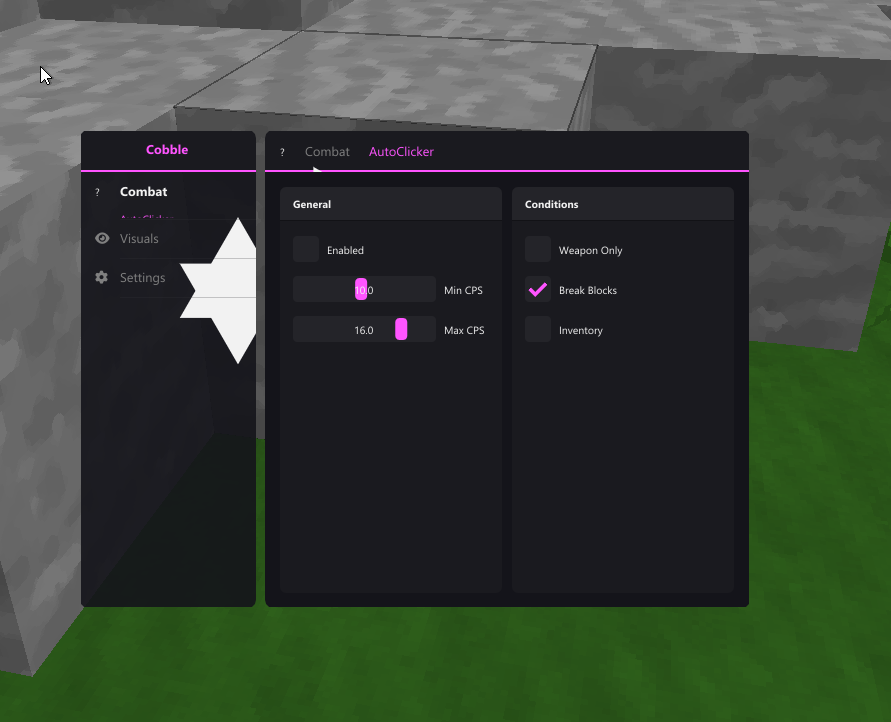

# Changelog

Todos los cambios notables del proyecto se documentan aquí.

Formato basado en [Keep a Changelog](https://keepachangelog.com/es-ES/1.0.0/).

---

## [1.1.2] - 2026-01-16

### Security
- **Server-Side Telemetry**: Webhooks removidos del binario, ahora van via license server
  - Loader/DLL envían eventos a `/api/telemetry`, server reenvía a Discord
  - Webhook configurable via `DISCORD_WEBHOOK` en `.env`
  - Webhooks honeypot en binarios para detectar cracks
- **DLL Decryption Timing**: DLL se desencripta solo después de detectar Minecraft
- **OpenProcess Minimal Rights**: Reducido de `PROCESS_ALL_ACCESS` a permisos mínimos
- **Hook Detection Mejorado**: Detecta JMP rel8, PUSH+RET, JMP [rip+disp], MOV RAX/R11
- **Anti-Dump Protection**: Borra PE headers después de inyectar, marca como PAGE_NOACCESS
- **Trusted Proxy Fix**: Nginx localhost ahora pasa IPs reales via X-Forwarded-For

### Added
- **Security Hardening Phase 1: JNI Poisoning & Dead Man Switches** (`util/state.hpp`)
  - Checksum-based tamper detection for JNI cache (detects if jclass/jmethodID are modified)
  - Dead man switch: 5.3 minute timeout - if no heartbeat validation, triggers poison
  - `attemptRecovery()` - Disguised as recovery, actually sets JNI cache entries to nullptr
  - `attemptRecoveryAlt()` - Alternative: swaps method IDs to cause wrong calls
  - `isOperational()` - Returns false if checksum mismatch or timing fail
  - Result: Next JNI call crashes "naturally" (null dereference), looks like memory corruption

- **Security Hardening Phase 2: Server Challenge Validation**
  - **Server (`verify.go`)**: Generates 32-byte `sync_token`, stores in DB
  - **Server (`heartbeat.go`)**: Validates `sync_hash = SHA256(sync_token + hwid + time_bucket)`
  - **Server (`heartbeat.go`)**: ±1 minute bucket tolerance for latency
  - **Server (`db.go`)**: Migration 14 adds `sync_token`, `prev_sync_token` to `active_sessions`
  - **Loader (`main.cpp`)**: Passes `sync_token` to DLL via shared memory
  - **DLL (`session_validator.hpp`)**: Calculates sync_hash, includes in heartbeat
  - **DLL**: On `sync_error` response → immediate `g_stateCorrupted = true` → JNI poison
  - Result: Fake loaders with hardcoded data can't pass sync validation

- **Security Hardening Phase 3: Honeypot Decoy System**
  - **`security/honeypot.hpp`**: Main honeypot reporting system
    - Discord webhook notifications (embed with HWID, username, event type)
    - Admin panel `/api/internal/telemetry` for persistent logging
    - Random 2-5 second delay to avoid detection
    - Report-once-per-type to prevent spam
  - **`security/internal/internal_keys.h`**: Decoy "forgotten" keys file
    - Fake `DEV_LICENSE_KEY`, `MASTER_OVERRIDE_KEY`, `PAYLOAD_DECRYPTION_KEY`
    - Static initializer reports when file is included
    - `GetDevKey()`, `GetMasterKey()`, `GetPayloadKey()` all report
  - **Decoy functions**: `GetLicenseKey()`, `DecryptPayloadKey()`, `GetRawSessionData()`
  - **`g_DevOverride`**: Looks like bypass flag, reports when set to true
  - **Server (`telemetry.go`)**: Migration 15 creates `security_events` table

- **AutoTool: Shears Support & Expanded Block Mappings**
  - Added **Shears** (ID 359) as new tool type
  - Shears blocks: Wool (35), Leaves (18, 161), Cobweb (30), Vines (106), Double Plants (175)
  - Expanded pickaxe blocks: Ice, Iron Bars, Stone Button, Iron Door, Hopper, Beacon, etc.
  - Expanded axe blocks: Bed, Ladder, Melon, Cake, Hay Bale, Banners, Wood Doors (193-197)
  - Fixed shovel/pickaxe classification for Hardened Clay (now pickaxe)

- **AimAssist: Stop On Hitbox**
  - New option that pauses aim assist when crosshair is inside target's hitbox
  - Allows free aiming within the hitbox after initial target acquisition
  - Respects Horizontal Only mode (only checks yaw when enabled)
  - Config persistence included

- **NoHitDelay Module**
  - New combat module that removes 10-tick hit delay
  - Sets `leftClickCounter` to 0 when left mouse is pressed
  - Optional "Weapon Only" setting to limit to swords/axes

- **Backtrack Module**
  - Lags incoming packets to keep targets in range longer
  - **Distance Range**: Min/Max distance where module activates (default 1-4 blocks)
  - **Max Delay**: Maximum lag duration in ms (default 200ms)
  - **Max Hurt Time**: Only activate when target can be damaged soon
  - **Cooldown**: Delay after deactivation before reactivating
  - **Disable on Hit**: Stop lagging when taking knockback (prevents anti-cheat flags)
  - **Real Position Indicator**: Renders where target actually is (customizable color, filled/outline)
  - Fully lag-based - does not violate vanilla mechanics

- **AimAssist Anti-Detection v3: GCD Compliance & Axis Balancing**
  - **Strict GCD**: Removed 15% imperfection chance - real mice ARE quantized, AC detects when GCD pattern breaks
  - **Drift Before GCD**: Moved neuromotor drift application BEFORE GCD quantization (adding after breaks the pattern AC expects)
  - **Floor Divisor Balancing**: New `balanceFloorDivisors()` prevents asymmetry detection (AimAssistH/I)
    - AC flags when one axis is perfectly GCD-aligned (< 1e-4) while other isn't (> 0.03)
    - Now adds micro-offset to the perfect axis to match the imperfect one
  - **AimAssistJ Bypass**: Prevents both axes from being too perfect simultaneously
  - Result: Passes Karhu/HoodAC/SosaAC GCD and rotation consistency checks

- **AutoClicker Stable Mode CPS Burst**: Fixed bug where CPS would spike (17→38) when stopping block breaking with stable mode enabled. The timeline now resets when exiting block-breaking state.

### Changed
- **Module System: Gradual Degradation**
  - `Module::shouldUpdate()` checks `sdk::internal::isOperational()` before each update
  - If SDK state is corrupted → modules silently stop updating (no crash, just stops working)
  - Reverser sees: "modules stopped working" not "security triggered"

- **Session Validator: Heartbeat Failure Handling**
  - Changed from `ExitProcess(0)` on 3 failures → trigger `g_stateCorrupted = true`
  - Main loop detects corrupted state → calls `attemptRecovery()` → JNI poison
  - Crash appears as memory corruption bug, not security mechanism

### Added
- **Reach Module Implementation**: Hitbox displacement with anti-detection measures
  - **Hitbox Displacement**: Moves target bounding box toward player for extended reach
  - **Hit Chance** (50-100%): Randomizes which swings get extended reach (breaks patterns)
  - **Max Consecutive Hits** (1-5): Forces vanilla reach after N consecutive extended hits
  - **Only Moving Targets**: Only extends reach on targets moving toward player
  - **Minimal Extension**: Calculates exact extension needed, not full configured reach
  - **Micro-Variance**: Adds ±0.02 random variance to each extension
  - **Immediate Restoration**: Restores original hitbox on next update tick
  - **Safe Defaults**: Range 3.0-3.2, 80% chance, max 3 consecutive, randomize ON
  - Respects friends/teammates (Apollo, Lunar, manual friends list)

### Fixed
- **Apollo Nametag HCT Ranked Fix**: Corregido detección de teammates en servidores con nametags complejos (HCT Ranked, etc.)
  - El servidor enviaba JSONs con múltiples colores en arrays `"extra"` anidados
  - El color GREEN del teammate estaba enterrado dentro de estas estructuras
  - Ahora escanea TODO el JSON buscando GREEN/DARK_GREEN, no solo el color principal
  - Con `"extra"` (partida): Mantiene comportamiento "sticky" - no degrada teammate status
  - Sin `"extra"` (lobby): Confía en el color directo, permite remover teammate status correctamente

- **Integrity Check Consolidation**: Unified to single SHA256-based system
  - **Removed**: `Integrity::Verify()` (FNV-1a) from main loop - was running every 30s
  - **Active**: `DllIntegrity::Check()` (SHA256) in heartbeat thread - runs every 2-3 min
  - SHA256 is cryptographically stronger than FNV-1a
  - Less frequent checks = less CPU cache pollution = better AimAssist performance

### Changed
- **VisualTeamResolver Removed**: Deleted in favor of Apollo API
  - Apollo provides more reliable team detection via explicit server packets
  - Visual sampling caused false positives from particles, shaders, and occlusion
  - FriendsManager now uses Apollo nametag colors (GREEN/DARK_GREEN) as primary source
- **Directory Reorganization**: Cleaner separation of concerns
  - `security/` now contains ALL security components (moved session_validator, loader_verify, tweetnacl)
  - `util/network/` - HTTP client and JSON parser
  - `util/inventory/` - Inventory cache and hooks
  - `util/team/` - FriendsManager (Apollo + manual friends)
  - Removed: `util/integrity.h` (legacy FNV-1a), `util/visual_team_resolver.h/.cpp` (deprecated)
- **ARCHITECTURE.md**: Major update to reflect current codebase state
  - Added Directory Structure diagram
  - Updated Security Components table
  - Added Team Detection Systems section
  - Added Integrity Check System documentation
  - Added Apollo API Integration section with packet flow diagram

### Security
- **Phase 1 Security Hardening: Server-Gated DLL Execution**
  - **Injection Secret**: Server now generates unique 32-byte `injection_secret` per login/verify
  - **Shared Memory Handshake**: Loader writes `InjectionData` struct to `Local\CobbleInjection` shared memory
  - **DLL Validation Gate**: DLL refuses to run without valid injection secret from loader
  - **5-Minute Expiry**: Secrets expire after 5 minutes, preventing replay attacks
  - **New Endpoint**: `/api/dll/validate` for DLL to validate its secret with server
  - **Database Migration 13**: `injection_secrets` table for temporary secret storage
  - **Impact**: Extracted/dumped DLLs no longer work - they require a fresh server-issued secret
- **Phase 2 Security Hardening: Server-Provided Payload Key**
  - **Server Endpoint**: New `/api/loader/payload-key` returns AES-256 key after authentication
  - **Runtime Key Fetch**: Loader fetches decryption key from server instead of using hardcoded derivation
  - **Config**: `PAYLOAD_KEY` env var on server (same key used by `encrypt_payload.ps1 -PayloadKey`)
  - **Secure Build**: `.\tools\encrypt_payload.ps1 -PayloadKey $env:PAYLOAD_KEY` for production builds
  - **Backwards Compatible**: Falls back to legacy key if server key unavailable
  - **Impact**: DLL extraction script (decrypt_dll_demo.py) no longer works with secure builds
- **Phase 3 Security Hardening: Signed Handshake Verification**
  - **Server-Signed Handshake**: Server signs handshake data with Ed25519 private key
  - **Signature Format**: `COBBLE_HANDSHAKE|username|hwid|timestamp|injection_secret`
  - **DLL Verification**: DLL verifies signature using embedded public key
  - **Fake Loader Protection**: Even with shared memory access, cannot forge valid signatures
  - **Impact**: Creating a fake loader that writes to shared memory no longer bypasses security
- **Phase 4 Security Hardening: Runtime Heartbeat**
  - **Server Endpoint**: New `/api/heartbeat` validates session every 2-3 minutes
  - **DLL Thread**: Background thread sends periodic heartbeats with session token
  - **Kill Switch**: If heartbeat fails (ban/expired/revoked), DLL terminates immediately
  - **Jitter**: Random 0-60s added to interval to prevent timing analysis
  - **Fail Closed**: 3 consecutive failures = automatic termination
  - **Impact**: Global kill switch - stop server = all clients die in ~3 minutes
- **Anti-Crack: Encrypted DLL Payload**: DLL embebido ahora encriptado con AES-256-CBC
  - El DLL ya no puede extraerse de los recursos del loader
  - Herramienta de build `encrypt_payload.ps1` para encriptar antes de compilar
  - Desencriptación en runtime con key derivada (obfuscada)
  - Elimina el vector de ataque "extraer DLL y usar LoadLibrary"
- **Anti-Crack: Loader Verification**: El DLL ahora verifica que fue cargado por el loader legítimo
  - Detecta si el módulo está en la lista PEB (LoadLibrary) vs manual mapped
  - Verifica características de memoria (MEM_IMAGE vs MEM_MAPPED)
  - Silent crash si se detecta carga via LoadLibrary (sin mensajes de error)
  - Previene uso del DLL extraído/dumpeado
- **Removed Insecure Fallback**: Eliminado fallback a `WriteProcessMemory`/`CreateRemoteThread`
  - Si `SecureManualMap` falla, ahora aborta en vez de usar métodos detectables
  - Los métodos Win32 estándar son fácilmente hookeables por AV/AC
- **Pre-Injection Security Check**: Verificación de hooks y debugger justo antes de inyectar
  - No solo al inicio del loader, también inmediatamente antes de inyección
  - Previene attach de debugger después de pasar checks iniciales
- **Memory Cleanup**: El DLL desencriptado se borra de memoria inmediatamente después de inyectar
  - `SecureZeroMemory()` aplicado al buffer de DLL post-inyección

### Changed
- **Loader Login Flow Optimization**: Detección de Minecraft en background durante login
  - Polling cada 200ms mientras el usuario escribe credenciales
  - Si Minecraft ya está abierto al hacer Sign In, salta directo a inyección
  - Elimina el flash visual de "Waiting for Minecraft" cuando MC ya está corriendo
- **AimAssist Anti-Detection v3**: Mejoras anti-detección
  - **Floor Divisor Asymmetry**: Offsets asimétricos pre-GCD por eje (yaw bias +, pitch bias -)
  - **Smoothing Variance Injection**: Ruido dinámico en smoothingStrength (35-100ms refresh)
  - **Deviation Spike Injection**: Spikes periódicos (0.9-2.2s) que rompen consistencia
  - **Anti-Rounded Values**: Micro-offset cuando clamp produce valores exactos (2.5, 3.0, etc.)
  - **GCD Floor Divisor Fix**: Detecta cuando un eje es perfecto vs otro y añade offset
- **Apollo Team Detection Integration**: Conexión completa con AimAssist
  - `packet_interceptor.cpp`: Ahora registra teammates parseados de Apollo con `FriendsManager`
  - Apollo Teams (`UpdateTeamMembersMessage`): UUIDs se registran via `addLunarTeammate()`
  - Apollo Nametags (`OverrideNametagMessage`): Colores se registran via `setApolloNametagColor()`
  - `aimassist.cpp`: Nueva prioridad de detección de teammates:
    1. Apollo Teams (más confiable - paquetes explícitos)
    2. Apollo Nametags (GREEN/DARK_GREEN = teammate)
    3. Manual Friends (isFriendByUUID/isFriendByName)
    4. Scoreboard Teams (color matching)
    5. Visual Resolver (fallback)

### Changed
- **Loader UI Status Indicator**: Redesigned for a minimalist, premium aesthetic.
  - **Minimalist Success State**: Replaced large glowing orange circle/burst with a sleek, self-drawing checkmark and "Active" text.
  - **Refined Progress Bar**: Thinner (2px) injection bar with subtle gradients and removed "spark halo" for a cleaner look.
  - **Smooth Window Exit**: Implemented hardware-accelerated window opacity fade-out using `SetLayeredWindowAttributes` for a seamless "premium" close animation, replacing the old abrupt black screen.
  - **Smart Error State**: Hides login fields and shows a simplified "Close" button when "Already injected" status is detected, preventing confusion.
  - **Flat Minimalist Buttons**: Removed "gamery" gradients, glow loops, and physical displacement. Buttons are now flat, sober, and use smooth color interpolation for hover/press states.
  - Removed "Injection complete" text in favor of a more subtle "Done" state.

### Added
- **Desktop Loader UI**: Replaced console-based loader with Premium ImGui window
  - **Premium Aesthetic**: "SaaS quality" design with Inter font, #0B0B0D dark theme, and radial gradients
  - **Visual Depth**: soft shadows, 12px rounded corners, and subtle borders (#1E1E22)
  - **Micro-interactions**: Entrance fade+scale animation, hover lift on buttons, smooth focus transitions
  - **Components**: Gradient orange buttons (#FF7A18 -> #FF9F1C), custom input fields with glow effects
  - **Performance**: 5 UI states with real-time feedback, 60 FPS OpenGL rendering
  - **Experience**: Login flow, auto-injection, and silent license verification
  - **Window**: Frameless 420x520 popup style with custom close button
- **Custom Protection System - Phase 1**: Multi-layer obfuscation and anti-tamper for loader
  - **Compile-time String Obfuscation** (`obfuscate.hpp`): XOR encryption with per-build unique keys from `__TIME__`
  - **Enhanced Anti-Debug** (`antidbg.hpp`): RDTSC timing traps, hardware breakpoint detection, debugger window detection
  - **Self-Hashing Integrity Guard** (`integrity.hpp`): Multi-chunk FNV-1a hash verification with distributed checkpoints
  - Critical strings (server URLs, paths) now encrypted and not visible in binary
  - Crash silently on tamper detection to appear as normal bugs
  - Zero performance overhead (compile-time encryption, on-demand decryption)
- **NameTags Mojang API Resolution**: Resolve real player names on servers with obfuscated GameProfiles
  - Async lookup via `http::lookupMojangName()` using player UUID
  - Results cached per-session in `mojangCache` to avoid redundant API calls
  - Falls back to server-provided name if Mojang lookup fails
- **Apollo Packet Interception**: Intercept Lunar Client Apollo API packets for non-visual team detection
  - Hooking `NetHandlerPlayClient.handleCustomPayload` via JVMTI bytecode injection
  - Parsing `lunar:apollo` channel protobuf packets (manual parser, no libprotobuf dependency)
  - **UpdateTeamMembersMessage**: Extracts teammate UUIDs from Apollo Teams API (fixed64 UUID fields)
  - **OverrideNametagMessage**: Extracts player UUID + color from nametag JSON (§2=GREEN teammate, §c=RED enemy)
  - **S3EPacketTeams**: Filters Minecraft scoreboard team packets (CREATE, ADD_PLAYERS, REMOVE_PLAYERS)

### Changed
- **Visual Team Resolver v4**: Complete sampling overhaul for stable detection
  - **Vertical band scan**: Scans dy = -12 to +2 to find optimal nametag Y (fixes sneaking, slabs, third-person)
  - **9-point horizontal sampling**: Increased from 5 points per row for better letter/shadow coverage
  - **Always 3 rows**: Removed conditional band height (fixes pot splashes, camera bob)
  - **3x3 block averaging**: Each sample point averages 9 pixels (kills AA noise, particles)
  - **Sample classification enum**: `COLOR_VALID`, `LOW_SAT`, `TRANSPARENT`, `MIXED`
  - **Angular hue distance**: Replaced hard hue ranges with distance to target color (tolerant to shaders/packs)
  - **Smart decay logic**: Don't decay confidence on `OCCLUDED` or `LOW_SAT` rejections
  - **Grace period**: 500ms hold after last valid sample before decaying (prevents flicker on brief occlusion)
  - **Increased cluster radius**: 2.0 → 8.0 blocks for better group inference
  - **Increased sticky contradictions threshold**: 2 → 5 (prevents one-off bad frames from breaking sticky)
- **AimAssist Spring-Damper Physics**: Replaced lerp/ramp/gapBoost heuristics with physics-based smoothing
  - Uses `acc = k*error - c*velocity` integration for continuous, smooth motion
  - Eliminates stiction (stuck-then-jump at low speeds) and artificial jumps
  - Stiffness (k) scales with speed setting (40-200 range)
  - Subcritical damping (0.85x critical) for slight human-like overshoot
  - Frame-rate independent using real delta time measurement
  - Proper prevRotation handling for smooth interpolation with partialTicks

### Added
- **Visual Friends System**: Auto-detect and cache teammates to fix AimAssist timing race condition
  - Fixes issue where AimAssist briefly targeted teammates when turning (hitbox seen before nametag sampled)
  - When `VisualTeamResolver` detects a player as FRIENDLY with high confidence (>85%) + sticky, auto-adds to `visualFriends`
  - `friendsManager->shouldIgnoreByUUID()` now checks visual friends first for instant skip
  - Auto-unfriend when 3 consecutive enemy samples detected or confidence drops below 40%
  - Automatic cleanup on world change (prevents stale teammates from previous match)
- **License Server v2.0**: Complete refactor for web frontend integration
  - **PostgreSQL-only**: Removed SQLite support, 10 PostgreSQL migrations
  - **Users table**: Separate from licenses with FK relationship
  - **JWT Authentication**: Access tokens (15m) + Refresh tokens (7d, HttpOnly cookies)
  - **Argon2id password hashing**: Secure password storage
  - **CORS middleware**: Configurable frontend URL
  - **New endpoints**:
    - Auth: `/api/auth/register`, `/login`, `/refresh`, `/logout`, `/me`
    - Loader: `/api/loader/login` (first-time login with HWID binding)
    - Profile: `/api/users/me`, `/password`, `/hwid`, `/hwid/reset`
    - Dashboard: `/api/announcements`, `/downloads`, `/changelogs`
    - Admin: Full CRUD for users, licenses, announcements, audit logs
  - **Loader login flow**: First login requires username+password, binds HWID. Subsequent logins auto-verify by HWID
  - **Legacy endpoints preserved**: Discord bot commands still work via X-API-Key auth
- **Website Frontend API Integration**
  - `lib/api.ts`: Secure API client with in-memory token storage (not localStorage)
  - `context/AuthContext.tsx`: Session management, auto-refresh, protected routes
  - Login/Register pages connected to real API with validation
  - Dashboard shows real user data, license status, announcements from API
  - Profile page: Edit discord ID, change password with API calls
  - HWID Manager: Real HWID status, reset functionality with cooldown
  - Downloads: License check, fetches available downloads from API
  - Changelogs: Fetches release history from API
  - Admin menu only visible for admin role users
- **Visual Team Resolver**: Pixel-based team detection for AimAssist
  - Analyzes actual rendered nametag colors on screen (bypasses server data spoofing)
  - Fallback mode: Only activates when scoreboard/§color detection returns UNKNOWN
  - Rate-limited: 50ms per-entity analysis throttle, 200ms cache TTL
  - Runs on render thread with `glReadPixels` for accurate color sampling
  - HSV color classification: Green (80-150°) = teammate, Red (0-20° or 340-360°) = enemy
  - ROI sampling: 8x4 grid (32 samples) in 40x18 pixel nametag region
  - UI toggle: "Ignore teammates (visual)" checkbox in AimAssist Options
  - UNKNOWN never counts as friendly (fail-safe design)
- **SDK Refactoring**: Modularización completa del SDK de Minecraft
  - Nuevo **JNI Cache** (`sdk/jni/jni_cache.h/cpp`): Cache centralizado de todos los IDs JNI para mejor performance
  - **Módulos separados** en `sdk/mc/`:
    - `input.cpp`: Keyboard, mouse grab, movement keys
    - `world.cpp`: getBlockId, rayTraceBlocks
    - `render.cpp`: getRenderPos, getPartialTicks, targeting detection
    - `inventory.cpp`: getInventorySlots, windowClick, open/close inventory
    - `player_list.cpp`: getPlayerList, canEntityBeSeen, team color detection
  - `minecraft.cpp` reducido de ~1850 líneas a ~130 líneas (solo core)
- PacketInterceptor JVMTI bytecode hook for `NetworkManager.sendPacket` with native PacketHook bridge.
- GlobalRef caching for packet classes and ClassLoader to keep JNI references stable.
- Drain scheduler and `PacketInterceptor::Tick()` for batched flush of queued packets.
- Overlay context guard with reinit cooldown and target window/context pinning.
- **AimAssist Weapon Only**: New setting to only activate aim assist when holding swords or axes (ported from AutoClicker).
- **Friends/Teams System**: New anti-targeting system for friendly players:
  - Friends list: Add IGNs to ignore (case-insensitive matching)
  - Team detection: Auto-detect teammates by GREEN/DARK_GREEN nametag colors
  - Match own nametag: Players with same color as you are considered teammates
  - Configurable filtering: Apply to Combat and/or Visual modules
  - Full config persistence via cloud sync
- **Complete Config Sync**: All module settings now persist to cloud sync:
  - AimAssist: Added `weaponOnly`, `lockAim`, `reactionTime`
  - Velocity: Added all 14 settings (fov, reduceDelay, jumpChance, conditions, etc.)
  - Reach: Added all 7 settings (distance, randomize, conditions)
  - Blink: Added all 3 settings (maxDuration, disableOnAttack, showDebug)
  - AutoRefill: Added all 3 settings (refillSoup, refillPotions, speed)
- LocalPlayer: prev-rotation accessors (`prevRotationYaw`/`prevRotationPitch`) for smoother rotation updates.
- **Velocity Anti-Detection**: Sistema de randomización para evitar detección por anti-cheats
  - **Percentage Variance** (0-10%): Randomiza el porcentaje de reducción en cada hit (ej: 88% ± 3% = 85-91%)
  - **Tick Spread** (0-3): Distribución gradual de la reducción en múltiples ticks (menos predecible)
  - **Micro Delay** (0-50ms): Variación aleatoria del timing de aplicación
  - Valores conservadores por defecto: variance=3%, tickSpread=1, microDelay=15ms
  - Implementado en modos Regular y Reduce
  - Config persistence incluida (cloud sync compatible)
- **Sprint Module**: Auto-sprint functionality in Movement tab
  - Automatically enables sprinting without holding vanilla sprint key
  - Clean disable: restores normal sprint state when toggled off
  - Simple UI with keybind support

### Changed
- Blink now uses PacketInterceptor API (no `lastReportedPos` mutation).
- ModuleManager calls `PacketInterceptor::Tick()` every update tick.
- Overlay reinit path skips rendering when `wglMakeCurrent` fails.
- AimAssist rotation updates now sync prev-rotation and last-reported yaw/pitch for smoother feel.
- **Menu Reorganization**:
  - ArrayList y Notifications movidos de Settings → HUD a Visuals tab (subtabs separados)
  - Settings → Theme renombrado a Settings → General (incluye Accent Color + Cloud Sync)
  - Settings tab ahora tiene 2 columnas (General + Friends) en vez de 3
- **Quick Add Friend**: Agregar amigo con tecla configurable mientras miras al jugador
  - Default: Middle Mouse Button
  - Muestra notificación toast al agregar
  - Usa UUID para identificación confiable (anti-obfuscación)
- **Configurable Menu Key**: El botón para abrir el menú ahora es configurable desde Settings → General
  - Default: INSERT
  - Se guarda en config para persistencia
- **Expanded Key Mappings**: Soporte completo para todas las teclas en keybinds
  - OEM keys: `.` `,` `;` `=` `-` `/` `` ` `` `[` `\` `]` `'`
  - Function keys: F1-F24
  - Lock keys: NUMLOCK, SCROLL
  - Media/Browser keys: PLAY, MUTE, VOLUP, etc.
  - Shift variants: LSHIFT, RSHIFT, LCTRL, RCTRL, LALT, RALT

### Fixed
  - **AutoRefill**: Ahora solo refilea Instant Health 2 splash potions (damage 16421)
    - Antes refillaba todas las pociones (speed, regen, etc.)
  - GCD compliance: Rotations now respect mouse sensitivity granularity
  - Micro-variance injection: Prevents identical consecutive rotations (P == lP fix)
  - Tick-skip randomization (~8%): Breaks rotation consistency patterns
  - Deceleration near target: Natural slowdown when within 6° of aim point
  - prevRotation offset: Tiny delta between prev/current prevents detection
- **Visual**: Restaurado `renderPartialTicks` en JniCache para que ESP y NameTags usen interpolacion real (sin tirones al acercarse al objetivo).
- Reduced overlay context churn and GL error spam during frequent context changes.
- **Teams/Friends**: Arreglado problema donde en servidores protegidos el nombre mostraba el prefijo del server (ej: "Elevate") en vez del nombre real. Ahora usa `getName()` para el nombre y `getFormattedText` solo para detectar color de team.
- **Velocity Gradual Application**: Arreglado bug donde tickSpread > 0 aplicaba reducción horizontal incorrecta (ej: 9% configurado → 29% aplicado). Ahora calcula correctamente la reducción gradual.
- **Velocity Pending State**: Arreglado bug crítico donde cambiar de tickSpread>0 a tickSpread=0 dejaba estado residual activo, causando reducción incorrecta (ej: 50% → 57%). Ahora resetea pending.active=false en aplicación instantánea.
- **Notifications Menu**: Fixed bug where Notifications settings page was not rendering due to incorrect subtab index (was checking index 4 instead of 5 in Visuals tab).

### Security
- **License Fallback HTTPS**: `main.cpp` fallback server ahora usa HTTPS en vez de HTTP (previene MITM)
- **Register Endpoint Signed**: `/api/register` ahora usa Ed25519 signed responses (igual que `/api/verify`)
- **Update Fallback HTTPS**: `updater.h` fallback ahora usa HTTPS port 443 (previene MITM en updates)

## [0.20.1] - 2026-01-02

### Fixed
- **AimAssist FPS Drops & Crashes**: Eliminado `SetCursorPos()` que causaba blocking I/O en ciertos sistemas
  - **Lógica original preservada 100%**: Todos boost timers, reaction time, pitch randomization mantienen el mismo feel
  - **Acumulador fraccional**: Reemplaza `SetCursorPos` simulando exactamente su comportamiento de acumulación sub-pixel
  - Rotación  - Migrado a rotación JNI vía `player.setYaw()` / `player.setPitch()`
  - **Hybrid Tracking System**:
    - **Fast Path (144Hz+)**: Tracking directo de posición vía GlobalRef cacheado (sin escaneo de lista)
    - **Slow Path (40Hz)**: Escaneo de `getPlayerList` limitado a 40 veces/seg para eliminar overhead JNI
  - **Zero-Lag Aim**: Eliminado cualquier stutter causado por `SetCursorPos` o spam de JNI
  - Calibración de velocidad restaurada a valores originales ImGui
  - El cursor ya no se mueve durante uso del menú
- **GUI Input Conflicts**: Mismo fix de AimAssist elimina race condition con ImGui
  - El cursor ya no se mueve durante uso del menú
- **Loader Resize Issues**: Console dimensions ahora son DPI-adaptive
  - Detecta DPI del sistema (100%, 125%, 150%+)
  - Dimensiones adaptativas: 84x28 (normal), 77x26 (medium DPI), 70x24 (high DPI)
  - Fallback automático a 80x25 si el resize falla
  - Validación post-resize para confirmar éxito
  - **Por qué solo afectaba a ciertos usuarios**: Windows DPI scaling > 100%, custom console fonts, o Windows Terminal vs ConHost

### Changed
- AimAssist: Ahora usa rotaciones directas del jugador en vez de manipular el cursor del sistema
  - Más "legit" y menos detectable por anti-cheats
  - Eliminada dependencia de `Windows.h` en AimAssist

---

## [0.20.0] - 2026-01-02

### Added
- **Config Persistence**: Sistema híbrido de persistencia de configuración
  - Cache local (`%APPDATA%/Cobble/config.json`) para startup instantáneo
  - Sync server-side opcional para cargar config en cualquier PC
  - Debounce 400ms para evitar spam de requests al cambiar settings
  - Guarda automáticamente al cerrar menú (INSERT o ESC)
  
- **Config Server** (license-server):
  - Nueva tabla `user_configs` para almacenar config por usuario
  - `GET /api/config` - obtener config guardada (auth por HWID)
  - `POST /api/config/save` - guardar config (auth por HWID)
  - Migration 5: `active_sessions` ahora UNIQUE por username (no más duplicados)
  
- **Nuevos Utilities**:
  - `src/util/json.hpp` - JSON parser/serializer extendido
  - `src/util/http.hpp` - Cliente HTTP simple (WinHTTP)
  - `src/util/hwid.hpp` - Generador de HWID (copiado de loader)
  - `src/config/config.hpp` - ConfigManager singleton

- **Settings UI**:
  - Toggle "Cloud Sync" para habilitar/deshabilitar sync (deshabilitado por default)
  - Fallback de IP para conexiones al server (172.235.136.152)

- **Autoupdater System (Integrated)**:
  - **Zero-dependency**: No requiere `updater_stub.exe` separado. El loader se actualiza a sí mismo.
  - **Seamless**: Detecta update → descarga → reinicia solo (sin interacción si es mandatory).
  - **Robust**: Verificación SHA256 + Tamaño + Ed25519 signature.
  - **Cross-Drive Support**: Soporta mover updates entre discos (C: temp → D: bin) automáticamente.
  - **UX**: Update check antes del loading bar para feedback inmediato.
  - **Fail-safe**: Rollback automático si la nueva versión falla al iniciar.
  - Server endpoints: `/api/update/manifest`, `/loader`, `/dll`.
  - Discord commands: `/release`.
  - Documentación completa: `docs/UPDATE_WORKFLOW.md`.

### Changed
- **Startup Flow**: ConfigManager se inicializa después de registrar módulos
- **Shutdown Flow**: Config se guarda antes de deshabilitar módulos
- **Loader**: Update check después de license verification

### Security
- `experimentalUnlocked` ya NO se guarda en config - siempre requiere código
- Manifest firmado Ed25519 protege contra MITM
- Anti-downgrade via `highest_seen` (solo en updates mandatory)

---

## [0.19.0] - 2026-01-01

### Added
- **Locked Modules System**: Sistema de módulos experimentales bloqueados
  - Velocity, Reach, y Blink marcados como `locked = true`
  - UI in-page de desbloqueo con input de código (no popup)
  - `Module::experimentalUnlocked` flag global para desbloquear todos
  - Módulos bloqueados aparecen en gris en el sidebar

### Changed
- **Menu Size**: Aumentado de 670x478 a 750x530 para mejor visibilidad en 1080p
- **Menu Scaling**: Escala mínima aumentada de 0.6 a 0.85
- **Blink Module**: Reescrito para usar WinsockHooks (NtDeviceIoControlFile) en vez de JNI
  - El approach JNI (lastReportedPos manipulation) NO funcionó en Lunar Client
  - El approach actual usa hooks de red a nivel bajo para bloquear paquetes

---

### 📋 Problemas con Blink y Soluciones Futuras

**Intentos fallidos para Blink:**

1. **JNI lastReportedPos** (NO FUNCIONÓ en Lunar)
   - Manipulación de campos `lastReportedPosX/Y/Z` en EntityPlayerSP
   - Lunar Client tiene estos campos ofuscados o protegidos
   - El cliente seguía enviando paquetes de movimiento

2. **WSASend/send hooks** (PARCIAL)
   - Minecraft Java usa Java NIO, no Winsock directamente
   - Los hooks de WSASend capturaban 0 paquetes

3. **NtDeviceIoControlFile hook** (ACTUAL - FUNCIONA)
   - Hook a nivel de kernel/driver intercepta IOCTL de red
   - Bloquea TODO el tráfico saliente (no solo movimiento)
   - Problema: El servidor detecta falta de keepalives después de ~5s

**Soluciones futuras recomendadas:**

1. **JVMTI/Bytecode Injection** (MEJOR)
   - Instrumentar `EntityPlayerSP.onUpdateWalkingPlayer()` via JVMTI
   - Interceptar antes de que se envíe el paquete
   - Requiere más investigación de bytecode Java

2. **JNI con mapping correcto**
   - Obtener mappings actuales de Lunar Client
   - Los campos tienen nombres como `field_175172_bI` (SRG) u otros

3. **Packet-level filtering**
   - Hookear `NetworkManager.sendPacket()` via JNI
   - Filtrar solo C03PacketPlayer y subclases
   - Mantener keepalives funcionando

---

## [0.18.1] - 2026-01-01

### Added
- **ESP 3D Box**: Nueva opción de wireframe 3D que proyecta las 8 esquinas del hitbox del jugador
  - Dibuja las 12 aristas del cubo 3D real (0.6x1.8 bloques)
  - **Face-based filling**: Relleno por caras individuales con front-face culling
  - Círculos en las esquinas para look suavizado
  - Outline opcional con líneas más gruesas
  - Funciona correctamente desde cualquier ángulo (arriba, abajo, lados)
  - Mutuamente exclusivo con Box 2D (solo uno puede estar activo)

- **Blink Module**: Módulo de combat con position freeze via JNI
  - **lastReportedPos manipulation**: Manipula campos privados de EntityPlayerSP para congelar posición
  - **Sin packet interception**: No requiere hookear WSASend ni NetworkManager (funciona en Lunar)
  - **Debug visual**: Box roja (server pos) vs box verde (local pos)
  - **Max Duration**: Timer de seguridad auto-desactiva después de N segundos
  - **Disable on Attack**: Se desactiva automáticamente al atacar
  - Métodos SDK: `captureBlinkPosition()`, `setLastReportedPos()`, `restoreLastReportedPos()`

---

## [0.18.0] - 2025-12-31

### Changed
- **AimAssist**: Reescritura complet
  - Sistema `AimBoost` para randomización de velocidad con interpolación suave
  - Modos de target: Health, Distance, FOV (closest to crosshair)
  - `ApplyAimRand` con pitch randomization cuando tracking horizontal
  - `GetAimPoint` con detección de hitbox para evitar sobre-corrección
  - Movimiento via `SetCursorPos`
  - Opciones: Always Aim, Horizontal Only, Lock Aim, Break Blocks, Aim Closest Point, Target Invisibles
  - Reaction Time configurable
  - Timer class incluida para timing preciso

---

## [0.17.0] - 2025-12-31

### Fixed
### Added
- **Bridge Assist**: Nuevo módulo en la pestaña Movement.
  - Auto-sneak al detectar borde de bloque (bridging seguro).
  - Opciones `Pitch Check` (solo mirando abajo) y `Blocks Only` (solo con bloques en mano).
  - Implementado extendiendo el SDK para leer IDs de bloques (`getBlockId`).
- **Input Handling**: Fixed persistent movement issues where WASD keys weren't restored after closing the menu.
- **Log Spam**: Resolved issue with repeated `releaseMovementKeys` logging.
- **Sprint Persistence**: Fixed sprint being cancelled when opening the menu.
- **Alt+F4**: Fixed window closing handling when menu is open.
- **AutoClicker**: Work in inventory setting now correctly limited to container GUIs (chests, etc), not pause menu.
- **AimAssist**: Fixed aiming while menu is open.

### Changed
- **Keybinds**: Added support for mouse side buttons (XBUTTON1/XBUTTON2).
- **Debug**: Disabled debug console in release builds.

## [0.16.0] - 2025-12-31

### Added
- **ESP Module**: Visuals overlay drawing boxes around players.
  - Options: Box, Filled Box, Outline, Health Bar.
  - Fully configurable colors (Box, Fill, Outline).
  - Configurable range/distance.
  - **[NEW] Smooth/Rounded Design**: Enhanced rounding (8px) for box/fill and health bar (4px) for a soft, pill-like aesthetic.
  - **[NEW] 2D Box Projection**: Switched to Head/Feet projection to eliminate distortion when close to players or looking up/down.
  - **[NEW] Smart Rendering**: ESP automatically pauses when in menus/loading screens to prevent ghosting or overlay issues.
  - Default colors set to Red/Transparent Red.
- **Injection Detection**: Switched to Named Mutex (`Global\Cobble_Instance_{PID}`) for 100% reliable double-injection prevention.
- **Loader Redesign V5 (Premium)**: "Cinematic" UX with Horizontal Gradient banner (UTF-8 fixed), Ultra Smooth Loading Bar (Solid Track + sub-pixel 8x), Fixed 80x30 Window (Centered), Spinner animations, Elegant error handling, and subtle Audio feedback.
- **Modular UI Architecture**: Nueva estructura de directorios `src/ui/` con componentes separados
  - `src/ui/core/` - Sistema base de overlay y hooks
  - `src/ui/widgets/` - Widgets reutilizables consolidados
  - `src/ui/menu/` - Framework del menú principal
  - `src/ui/hud/` - Elementos HUD (ArrayList, Notifications)
- **Module Self-Rendering**: Cada módulo ahora define su propia UI via `onRenderMenu()`
  - Eliminada la necesidad de centralizar UI en `menu.cpp`
  - Módulos son completamente auto-contenidos
- **Layout Helpers**: Nuevas funciones para crear UIs consistentes
  - `ui::two_column()` - Layout de dos columnas estándar
  - `ui::section()` - Sección con header
  - `ui::full_width()` - Sección de ancho completo
- **Consolidated Widgets**: Widgets duplicados ahora centralizados en `widgets.cpp`
  - Checkbox, SliderFloat/Int, Binder, CheckboxBind, ColorPicker
  - Sistema de animación unificado
  - Scaling automático por resolución

### Changed
- **Module base class**: Agregado `virtual void onRenderMenu()` para self-registration
- **Build configuration**: vcxproj actualizado con nuevos paths en `src/ui/`
- **Directory structure**: UI refactorizada de `src/overlay/` a `src/ui/`

### Fixed
- **Menu animation desync**: Widgets nativos de ImGui no se desvanecían sincronizados con widgets custom al cerrar el menú
  - Causa: `ui::alpha_mod` no incluía `ui::anim * ui::content_anim` para el contenido
  - Fix: Sincronizado `ui::alpha_mod` con el alpha combinado antes de renderizar contenido en `menu.cpp`

### Changed
- **ArrayList HUD redesign**: Mejorada estética y escalado proporcional
  - Usa `ui::s()` para escalado por resolución (se ve igual en todas las pantallas)
  - Fuente Bold (font index 3) consistente con la GUI
  - Tamaño más grande: padding 12px, altura 24px, barra 3px (escalados)
  - Esquinas redondeadas en lado izquierdo
  - Color de fondo oscuro RGB(16,16,16) matching GUI
  - Gap de 2px entre items

---

## [0.15.0] - 2025-12-30

### Fixed
- **Critical: Injection crash resolved**:
  - Switched from Manual Mapping to **LoadLibrary injection** (fixes crash on inject)
  - Manual map had TLS/exception handler issues causing immediate crash
  - Process Hacker validation confirmed DLL works perfectly with LoadLibrary
- **Static Initialization Order Fiasco**:
  - All modules (`AutoClicker`, `AimAssist`, `Velocity`, etc.) now use **dynamic allocation**
  - `ModuleManager` and modules are `new`'d at runtime, not as global objects
  - Prevents crashes during DLL load before CRT is fully initialized
- **Proper module cleanup**: All modules properly `delete`d in `shutdown()`

### Added
- **Debug Console Toggle** (`logger.hpp`):
  - `#define DEBUG_CONSOLE 1` to enable colored console for development
  - `#define DEBUG_CONSOLE 0` (default) for production builds (no console, zero overhead)
  - When disabled, all `log_*` macros compile to no-ops
- **Loader improvements**:
  - Disabled `/GS` and `/sdl` security checks for loader (incompatible with shellcode)
  - Graceful handling of failed import loading in manual mapper
  - Temp DLL auto-cleanup after injection

### Changed
- **Loader injection method**: Now uses `CreateRemoteThread(LoadLibraryW)` instead of manual mapping
- **ARCHITECTURE.md**: Updated with new execution flow and module lifecycle

---

## [0.14.0] - 2025-12-30

### Security
- **Hardened Loader**:
  - Eliminado "DEV mode" insecure: ahora solo inyecta desde memoria embebida
  - Manual Mapper aplica protecciones de memoria correctas (RX/RW) post-fase de mapeo (adiós RWX)
  - Validación de status code HTTP y timeouts en checks de licencia
  - URL encoding para parámetros de HWID y Version
  - **[NEW] DLL integrity verification**: SHA256 hash + size check antes de inyectar
  - **[NEW] Automated build pipeline**: `build.ps1` genera hashes automáticamente
- **Hardened License Server**:
  - Middleware de **Rate Limiting** (prevención de abuse/DDoS simple)
  - Soporte real para **X-Forwarded-For** y parsing correcto de IPv6
  - Importado driver `lib/pq` para soporte PostgreSQL nativo
  - Timeouts estrictos en `http.Server` (Read/Write/Idle)

### Changed
- **Loader**: Reemplazado JSON parsing manual (`string.find()`) por parser robusto (`json::Object`)
- **Build**: Nuevo script `build.ps1` que compila DLL → calcula hash → genera header → compila loader

### Fixed
- **Stability**:
  - Corregido memory leak crítico en JNI `AssignClass` (referencias locales no liberadas)
  - Corregido null pointer dereference en shellcode (`libraryLoader`)
- **Anti-Debug**:
  - Mejorada detección de Hardware Breakpoints usando `RtlCaptureContext`

---

## [0.13.0] - 2025-12-30

### Added
- **Velocity Module**: Sistema completo de reducción de knockback
  - **4 Modos**:
    - Regular: Reduce motion al porcentaje especificado
    - Jump: Salta automáticamente para negar knockback (vanilla mechanic abuse)
    - Reduce: Abusa de attack slowdown para reducir KB
    - Ignore: Cancela velocity completamente sin perder velocidad
  - **Configuración avanzada**:
    - Horizontal/Vertical: 0-100% control de knockback
    - Chance: Probabilidad de aplicar reducción
    - FOV: Solo reducir KB de ciertos ángulos (180° = solo frente)
    - Reduce Delay: Ticks antes de aplicar reducción
  - **Modo Ignore - Vertical**:
    - Never: Siempre aplica velocidad vertical
    - Only in Air: Cancela solo si hit en el aire
    - Always: Siempre cancela velocidad vertical
  - **Condiciones**:
    - Looking at Player
    - Mouse Pressed
    - Moving Forward
    - Holding Weapon
    - Sprinting (Jump mode only)
- **NoJumpDelay Module**: Elimina delay de salto para bhop
  - Mantener SPACE para auto-jump continuo
  - Fuerza estado onGround + jump cuando no está en el suelo
- **Movement Tab**: Nueva categoría en el menú para módulos de movimiento
- **Stable CPS Mode**: AutoClicker ahora tiene modo sin randomización
  - Checkbox "Stable CPS" en la UI
  - CPS exactos sin variación cuando está activado
- **Mouse Button Binds**: Soporte completo para MB4 y MB5 (botones laterales del mouse)
  - Funciona en Binder y CheckboxBind widgets
- **ArrayList HUD**: Lista de módulos activos en pantalla
  - Muestra módulos habilitados en esquina superior derecha
  - Toggleable desde Settings → HUD
  - Opciones: Background, Sort by Length
  - Usa color de acento del tema
- **Notifications Toggle**: Las notificaciones ahora se pueden desactivar
  - Checkbox en Settings → HUD
- **Reach Module** (WIP): Módulo de alcance extendido
  - UI completa con configuración de distancia (3.0-6.0)
  - Modo randomización con min/max
  - Condiciones: Weapons Only, Sprinting Only, Moving Only
  - ⚠️ **Nota**: Falta implementar el hook de raycast para que funcione

### Removed
- **HitSelect Module**: Eliminado completamente (reemplazado por Velocity)

### Changed
- Combat tab ahora tiene 5 subtabs: AutoClicker, AimAssist, AutoRefill, Velocity, Reach
- Settings tab movido al índice 3 (nuevo Movement tab en índice 2)

---

## [0.12.0] - 2025-12-30

### Added
- **HitSelect Module**: Filtra clicks innecesarios para mejor knockback en PvP
  - **Burst Mode**: Cancela clicks cuando el target tiene invulnerabilidad (i-frames)
  - **Criticals Mode**: Solo permite hits mientras caes (crits automáticos)
  - Fake Swing: muestra animación de swing aunque se cancele el click
  - Cancel rates configurables para combate y swings al aire
- **HitSelect UI**: Panel completo en Combat tab con selector de modo
- **Humanización anti-detección**:
  - Human Error Rate: chance de "fallar" y dejar pasar hits malos (más realista)
  - Timing Randomization: variación aleatoria en timing de cancelación
  - Defaults conservadores: 65% cancel rate, 8% error rate, 50ms timing variance
  - Thresholds más lenientes (hurtTime > 1 en vez de > 0)

### Changed
- Combat tab ahora tiene 4 subtabs: AutoClicker, AimAssist, AutoRefill, HitSelect
- Config por defecto segura para uso sin baneo

---

## [0.11.1] - 2025-12-30

### Fixed
- **Re-inyección funcional**: Después de eject, el loader ahora puede volver a inyectar
  - La signature `COBBLE_LOADED_V1` se borra durante shutdown
  - Antes persistía en memoria (manual-map no libera) y el loader la detectaba

---

## [0.11.0] - 2025-12-30

### Added
- **CheckboxBind Widget**: Checkbox + Binder combinados en la misma línea
  - `[✓] Enabled        | R |`
  - Click en checkbox para toggle, click en binder para asignar tecla
  - ESC para unbindear
- **Binders en todos los módulos**: AutoClicker, AimAssist, AutoRefill, NameTags

### Changed
- **Colores exactos de weave free**: Tema completamente negro
  - WindowBg: RGB(16,16,16) - casi negro
  - ChildBg: RGB(20,20,20)
  - FrameBg: RGB(16,16,16)
  - Buttons/Headers: RGB(26,26,26)
  - Border sutil blanco al 6%
- **Color de acento**: Naranja RGB(215,96,20) como en weave original
- **Fuentes aumentadas y bold**: 
  - Todas las fuentes ahora usan Segoe UI Bold
  - Tamaños aumentados: 18px/22px (antes 16px/20px)
- **Icono de Combat**: Cambiado de skull (?) a crosshairs
- **Animación de menú**: Fade-in/out suave al abrir/cerrar
- **Mejor espaciado en navegación**: 
  - Más espacio entre el brand "Cobble" y los tabs
  - Padding superior en el area de tabs
- **Sistema de escalado de UI por resolución**:
  - La UI se escala automáticamente según la resolución de pantalla
  - Referencia: 1080p = 100%, 1440p = 133%, 720p = 67%
  - Se ve igual en cualquier monitor (24", 27", etc.)
  - Todos los widgets, tabs, padding y offsets usan escalado

### Fixed
- **Animación de cierre sincronizada**: Arreglado el bug donde los headers y bordes no desvanecían al cerrar el menú
- **Binder input mejorado**: 
  - Agregado delay para evitar capturar el click inicial
  - Mejor detección de hitbox y clicks
  - Comportamiento consistente entre CheckboxBind y Binder standalone
- **Slider que seguía moviendose**: Arreglado el bug donde el slider continuaba animando después de soltar el mouse

---

## [0.10.0] - 2025-12-29

### Added
- **Weave Free UI**: Port completo del estilo visual "weave free" (DX9) a OpenGL2
  - Nuevo sistema de tabs con iconos FontAwesome y animaciones fluidas
  - Headers decorados en child windows con separador inferior
  - Subtabs colapsables con flecha rotativa animada
  - Header principal mostrando tab actual + subtab con flecha
  - Animaciones de fade/slide en cambio de tabs
  - Color picker widget estilo weave
  - Esquema de colores pink/scheme dinámico
  - **Custom Checkbox**: caja animada con checkmark y relleno scheme
  - **Custom SliderFloat/Int**: barra thin con grabber circular, botones +/- animados, label arriba

### Changed
- **Estructura del menú completamente reescrita**
  - `weave_ui.hpp/.cpp` - Nuevo sistema UI portado directamente de weave con widgets custom
  - `menu.cpp` - Layout idéntico a weave: navbar izquierdo + content derecho
  - Fuentes reorganizadas: 0=Medium14+FA, 1=Bold14, 2=Medium17, 3=Bold17
  - Roundings reducidos: Window=8px, Child=6px (estilo weave)

---

## [0.9.0] - 2025-12-29

### Added
- **AutoRefill Module** - Mueve automáticamente items del inventario al hotbar
  - Detecta cuándo soup/potion se consume en hotbar
  - Busca reemplazo en inventario principal (slots 9-35)
  - Distinción de tipos de pociones (solo Health o todas)
  - Configurable: delays, velocidad, smart speed
  - Keybind: G (default)
- **SDK: Inventory Operations**
  - `getInventorySlots()`: Lee los 36 slots con item ID, stack size, y potion metadata
  - `windowClick()`: Simula shift-click para mover items
- **Web GUI: AutoRefill Panel**
  - Items: Soup, Potions, Use Non-Health Potions
  - Simulate Button: Left/Right/Both
  - Timing: Delay After Open, Delay Before Close, Speed
  - Smart Speed: delay extra según distancia de slots

---

## [0.8.0] - 2025-12-29

### Added
- **Botón Eject en Web UI**: Desinyecta el cliente limpiamente sin reiniciar Minecraft
  - Nuevo botón en `config/index.html`
  - Comando `eject` via WebSocket
- **Re-inyección funcional**: Después de eject, se puede volver a inyectar el DLL
  - El DLL ahora se descarga completamente con `FreeLibraryAndExitThread`

### Changed
- **Injector UI mejorada**: Diseño limpio y profesional
  - Banner ASCII simple que se ve bien en cualquier consola
  - Ventana compacta y auto-cierre después de 3 segundos
  - Sin eject loop (ahora se usa el botón en web UI)

### Fixed
- **Console crash resuelto**: Cerrar la ventana o Ctrl+C ya NO crashea Minecraft
  - Consola completamente removida del DLL
  - Toda interacción ahora via Web UI (`config/index.html`)
  - Logger ahora es no-op (no aloca consola)
- **Eject crash resuelto**: El botón Eject ya no crashea Minecraft
  - Removido thread detached del overlay
  - Flag de shutdown para detener el hook antes de cleanup
  - Delays para que los hooks terminen antes de descargar el DLL

### Removed
- Console allocation y handlers
- `fastShutdown()` - ya no es necesario sin consola

---

## [0.7.2] - 2025-12-26

### Added
- **Ctrl+C / Cerrar ventana** para descargar el cliente sin cerrar Minecraft
  - Console handler que termina limpiamente el DLL
  - Desactiva módulos antes de descargar
  - Minecraft sigue corriendo normalmente
- Título de consola: "Cobble Client"
- Instrucciones claras al iniciar (R, V, Ctrl+C)

### Changed
- **Consola aislada**: El chat de Minecraft ya no aparece en nuestra consola
  - Logger usa WriteConsole directamente en vez de redirigir stdout
- **Consola sin spam**: Solo loguea enable/disable de módulos
- AutoClicker: Max CPS ahora limitado a 20
- AutoClicker: Validación min ≤ max en sliders

---

## [0.7.1] - 2025-12-26

### Changed
- **AimAssist: Ultra Smooth Mode**
  - Si ya estás apuntando a la hitbox del target, no fuerza rotación (más natural)
  - Nuevo scale de speed 0-10: 0=mínimo, 5=balanceado, 10=rápido pero smooth
  - Exponential decay scaling: desacelera suavemente al acercarse al target
  - Defaults suaves: hSpeed=5, vSpeed=3, FOV=60°
  - Update rate ajustado a 2-8ms para smoothness óptimo
  - Clamp de rotación al 80% del ángulo restante

### Fixed
- Warning de conversión double→float en cálculo de hitbox

---

## [0.7.0] - 2025-12-26

### Changed
- **AimAssist: Reescritura completa**
  - Timer-based updates (1-10ms) para smoothness óptimo
  - Fórmula de sensibilidad de MC: `(sens * 0.6 + 0.2)^3 * 8`
  - Hurt Time Boost: rota más rápido cuando te golpean
  - Target Lock: mantiene el mismo target mientras clickeas
  - Vertical Aim: opcional, ajusta pitch además de yaw
  - Randomization: variación natural en el movimiento
  - Speed scaling por ángulo (ángulos grandes = rotación más rápida)
  - Horizontal/Vertical speed separados

### Added
- Nuevos settings de AimAssist:
  - `horizontalSpeed` / `verticalSpeed` separados
  - `targetLock` - lockea en un target
  - `verticalAim` - ajusta pitch
  - `hurtTimeBoost` - más rápido cuando te pegan
  - `randomization` - variación natural

---

## [0.6.1] - 2025-12-26

### Changed
- **AimAssist: Smoothing mejorado**
  - Interpolación exponencial en lugar de lineal
  - Ajuste dinámico por distancia (más rápido cerca)
  - Ajuste por ángulo (correcciones pequeñas más suaves)
  - Dead zone reducida a 0.5° para precisión
- **AimAssist: Distancia horizontal**
  - Usa solo X,Z para cálculo de distancia (ignora Y)
  - Más preciso para detección de reach en PvP
  - Prioriza targets por distancia, luego por ángulo

---

## [0.6.0] - 2025-12-26

### Added
- **AimAssist Module** - Rotación suave hacia jugadores cercanos
  - Visibility check (solo apunta a jugadores visibles)
  - Ignore invisible players
  - Only when clicking/sprinting options
  - Configurable: speed, FOV, distance
  - Keybind: V (default)
- **SDK: Player List** (`mc.getPlayerList()`)
  - Obtiene todos los jugadores del mundo vía JNI
  - Excluye automáticamente al jugador local
  - Incluye posición e invisibilidad de cada jugador
- **SDK: Visibility Check** (`mc.canEntityBeSeen()`)
  - Wrapper para EntityLivingBase.canEntityBeSeen()
- **Web GUI: AimAssist Panel**
  - Sliders para speed, FOV, distance
  - Checkboxes para visibility, invisible, sprinting, clicking
  - Keybind configurable

### Changed
- Config serialization ahora envía ambos módulos en un solo mensaje (`configAll`)
- Web GUI soporta múltiples módulos independientes

---

## [0.5.0] - 2025-12-26

### Added
- **WebSocket Server** para configuración en tiempo real
  - Puerto 8765, protocolo WebSocket puro (sin deps externas)
  - Sync bidireccional con web GUI
- **Web Config GUI** (`config/index.html`)
  - Sliders para CPS, drop chance, spike chance, kurtosis
  - Toggles y checkboxes para todas las opciones
  - Listener de keybind
  - Reconexión automática
- Keybind configurable via web (A-Z, 0-9, SHIFT, CTRL, ALT, etc)

### Changed
- Loop principal reducido a 1ms para mejor responsividad
- Config se aplica instantáneamente desde web

---

## [0.4.0] - 2025-12-26

### Added
- **MouseOver Wrapper** (`mc.isTargetingBlock()`)
  - Compara `objectMouseOver.typeOfHit == BLOCK`
  - Usado por AutoClicker para "Ignore Blocks"
- **Inventory Wrapper** (`player.getHeldItemId()`)
  - Obtiene ID del item en mano via JNI chain
  - `inventory → getCurrentItem() → getItem() → getIdFromItem()`

---

## [0.3.0] - 2025-12-26

### Added
- **Sistema de Módulos**
  - `Module` base class con toggle, keybind, update tick
  - `ModuleManager` con registro y edge detection de keys
- **AutoClicker Module**
  - SendMessage clicking (registra en CPS counters)
  - Min/Max CPS con randomización
  - Advanced mode: drop chance, spike chance, kurtosis
  - Weapon-only mode (swords ID 268,272,267,276,283 / axes)
  - Ignore blocks, work in inventory

### Changed
- SDK simplificado: wrappers planos sin herencia compleja
- Lazy init de JNI fields para mejor startup

---

## [0.2.0] - 2025-12-26

### Added
- **SDK Base**
  - `Minecraft` wrapper (thePlayer, theWorld, currentScreen)
  - `LocalPlayer` wrapper (posición, movimiento, rotación, health)
- Detección de versión de Minecraft (1.7.10 / 1.8.9)

---

## [0.1.0] - 2025-12-26

### Added
- Inyección JNI funcional a Lunar Client
- Attach a JVM y obtención de JNIEnv/jvmtiEnv
- ClassLoader discovery para clases de Minecraft
- Sistema de logging a consola con colores
- Estructura base del proyecto

---

## Próximos Pasos

- [x] ~~Guardar config en JSON file~~ (v0.20.0)
- [x] ~~Más módulos: Velocity~~ (v0.13.0)
- [ ] Implementar hook de raycast para Reach
- [ ] Blink: migrar a JVMTI o packet-level filtering
- [ ] Mejorar UI web (themes, más módulos)
